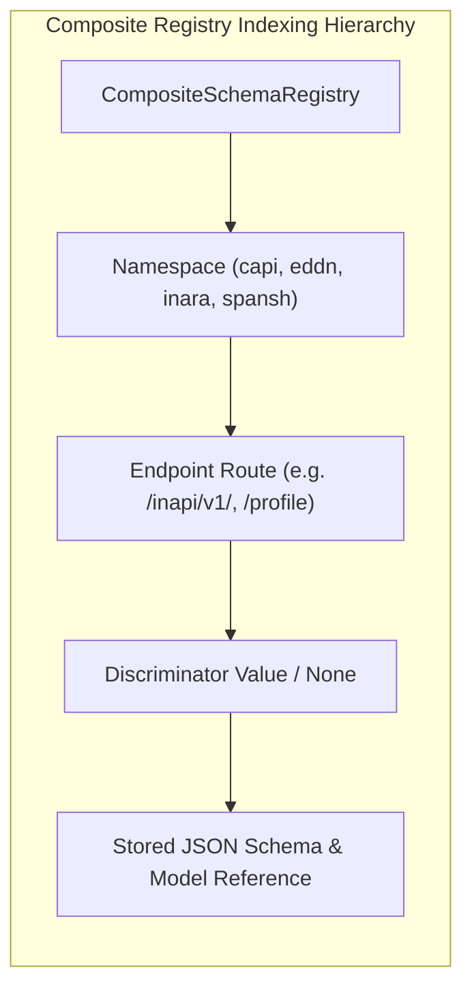

# ADR 0001: Multi-Namespace Manifest Loading and Composite Schema Registry

## Context and Problem Statement

The Elite Dangerous integration fleet (`ed-connectors`, `ed-telemetry`) interacts with disparate external API targets (`Frontier CAPI`, `EDDN`, `Inara`, `Spansh`, `EDSM`). Each provider employs unique structural endpoint compositions:
1. **Pattern 1: 1:1 Direct REST Endpoints:** Frontier CAPI (`/profile`, `/market`) maps the entire response body directly to a single dedicated schema.
2. **Pattern 2: 1:N Root Discriminator Polymorphism:** EDDN (`/upload/`) dispatches heterogeneous event payloads (`journal`, `commodity`, `shipyard`) identified dynamically by a root-level `$schemaRef` string URI.
3. **Pattern 3: 1:N Nested Batch-Item RPC Discriminators:** Inara (`/inapi/v1/`) dispatches batch requests containing an array of events (`events[]`) where each item's `eventName` field discriminates the sub-schema for `eventData`.
4. **Pattern 4: 1:1 Parameterized REST Queries:** Spansh (`/api/systems`) binds request query parameters or request bodies to deterministic response schemas.

In a unified `ed-connectors` architecture ([RFC 0001](file:///home/michael/src/github.com/mnaatjes/ed-schema/architecture/rfcs/0001_fleet_unification_and_provider_subpackage_architecture.md)), all provider schemas are co-located in subpackages (`src/ed_connectors/adapters/driven/providers/<target>/schemas/`).

How should `ed-schema` organize, ingest, and index contracts across multiple isolated provider namespaces without creating separate registry classes, leaking domain concepts, or suffering schema key collisions?

---

## Decision Drivers

* **Single Unified Registry Structure:** Avoid maintaining separate registry classes (`DirectRegistry`, `PolymorphicRegistry`, `BatchRegistry`) in favor of a universal composable lookup mechanism.
* **Namespace Isolation:** Strict boundary segregation between providers (`"capi"`, `"eddn"`, `"inara"`, `"spansh"`) so schemas with identical names (e.g. `profile.json`) never collide.
* **Multi-Namespace Directory Ingestion:** Programmatic ingestion of schema files directly from provider manifest declarations (`ProviderManifest.schema_dir`).
* **Zero Business-Logic Knowledge:** Total agnosticism toward Elite Dangerous game concepts (stars, ships, commodities).
* **Thread-Safe In-Memory Retrieval:** Microsecond-latency resolution suitable for real-time telemetry streaming in Linux and native Windows NT environments.

---

## Considered Options

* **Option 1: Disparate Registry Classes Per Composition Archetype.** Author specialized registry implementations for each of the four composition patterns.
  *(Rejected: Proliferates classes, forces callers to know which subclass to instantiate, and duplicates internal storage mechanics).*
* **Option 2: Flat Global Keying.** Register all schemas globally using only their relative file paths or URLs.
  *(Rejected: High collision risk; cannot distinguish 1:1 REST endpoints from nested RPC event discriminators).*
* **Option 3: 4-Tuple Composite Keying with Multi-Namespace Manifest Loading.** Unify all patterns through an immutable 4-tuple key: `(namespace, endpoint, discriminator_field, discriminator_value)`. Missing discriminator fields represent the degenerate 1:1 case.

---

## Decision Outcome

Chosen Option: **Option 3: 4-Tuple Composite Keying with Multi-Namespace Manifest Loading**.

### 1. Unified Key Hierarchy Across Composition Patterns



All fleet target patterns map cleanly to a single immutable dataclass key:

```python
@dataclass(frozen=True)
class SchemaKey:
    """Universal 4-tuple composite locator for any registered API contract."""

    namespace: str  # e.g., "capi", "eddn", "inara", "spansh"
    endpoint: str  # e.g., "/profile", "/upload/", "/inapi/v1/", "/api/systems"
    discriminator_field: str | None = (
        None  # e.g., "$schemaRef", "eventName", or None
    )
    discriminator_value: str | None = (
        None  # e.g., "journal/1", "getCommanderProfile", or None
    )
```

#### Mapping All 4 Fleet Patterns to the Unified Key

| Pattern | Example Target | `namespace` | `endpoint` | `discriminator_field` | `discriminator_value` | Target Contract Description |
| :--- | :--- | :--- | :--- | :--- | :--- | :--- |
| **P1: 1:1 Direct REST** | Frontier CAPI Profile | `"capi"` | `"/profile"` | `None` | `None` | Full HTTP response payload |
| **P2: 1:N Root Discriminator** | EDDN Journal | `"eddn"` | `"/upload/"` | `"$schemaRef"` | `"journal/1"` | Nested `message` object schema |
| **P2: 1:N Root Discriminator** | EDDN Commodity | `"eddn"` | `"/upload/"` | `"$schemaRef"` | `"commodity/3"` | Nested `message` object schema |
| **P3: 1:N Batch RPC Envelope** | Inara Envelope | `"inara"` | `"/inapi/v1/"` | `None` | `None` | Top-level batch envelope |
| **P3: 1:N Batch RPC Sub-Event** | Inara Profile Event | `"inara"` | `"/inapi/v1/"` | `"eventName"` | `"getCommanderProfile"` | Nested `eventData` sub-schema |
| **P3: 1:N Batch RPC Sub-Event** | Inara Set Ship Event | `"inara"` | `"/inapi/v1/"` | `"eventName"` | `"setCommanderShip"` | Nested `eventData` sub-schema |
| **P4: 1:1 Parameterized REST** | Spansh Systems | `"spansh"` | `"/api/systems"` | `None` | `None` | Parameterized JSON response |

---

### 2. Multi-Namespace Manifest Loading & Ingestion

`ed-schema`'s driving facade (`SchemaEngine`) and driven storage adapter (`FileSystemSchemaStorageAdapter`) ingest schema hierarchies declaratively from provider manifests:

```python
class CompositeSchemaRegistry:
    def __init__(self) -> None:
        self._entries: dict[SchemaKey, SchemaDefinition] = {}

    def register(self, key: SchemaKey, schema: SchemaDefinition) -> None:
        """Stores a schema definition indexed by composite key."""
        self._entries[key] = schema

    def resolve(self, key: SchemaKey) -> SchemaDefinition | None:
        """Resolves a registered schema definition in microseconds."""
        return self._entries.get(key)

    def load_from_manifests(self, manifests: Sequence[Any]) -> None:
        """Batch loads schemas across multiple isolated provider subpackages."""
        for manifest in manifests:
            # manifest.name provides the namespace ("capi", "inara", etc.)
            # manifest.schema_dir provides the co-located directory on disk
            self._load_namespace_directory(manifest.name, manifest.schema_dir)
```

---

## Consequences

### Positive Consequences
* **Unified Registry Mechanics:** A single registry class handles all current and future API targets across the fleet.
* **Zero Collision Risk:** Namespace scoping ensures identical schema file names in different providers remain strictly isolated.
* **Deterministic Resolution:** Lookup operations are $O(1)$ dictionary lookups with microsecond latency.
* **Total Business-Logic Ignorance:** Operates exclusively on abstract strings, descriptors, and schema definitions.

### Negative Consequences & Mitigations
* **Nested Resolution Requirement:** Pattern 3 (Inara) requires two registry lookups (one for the envelope, one for each sub-event).
  * *Mitigation:* Ergonomic helper methods (`resolve_from_payload()`) automatically extract discriminator fields from payloads and resolve the corresponding sub-schemas.
