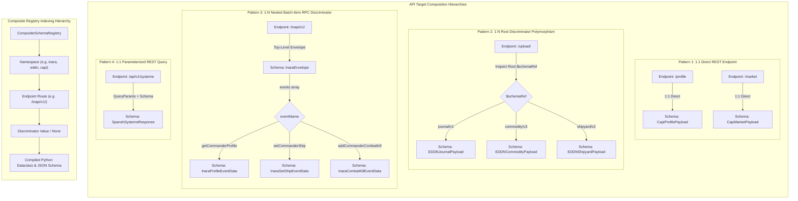

# ADR 0001: Purpose, Scope, Capabilities, and Boundary Taxonomy of ed-schema

## Context and Problem Statement

The Elite Dangerous integration ecosystem (`ed-capi`, `ed-eddn`, `ed-inara`, `ed-connectors`, and local `ed-telemetry`) interacts with diverse remote APIs and telemetry streams. Each external boundary imposes disparate data contracts:
1. **Frontier CAPI:** Textual, undocumented, or partially documented JSON structures with version drift across game updates.
2. **EDDN (Elite Dangerous Data Network):** Formal JSON Schema specifications (Draft-04 / Draft-07) keyed by schema URLs with polymorphic payloads (`$schemaRef`).
3. **Inara API:** RPC-like batch endpoints where a single HTTP endpoint (`/inapi/v1/`) dispatches multiple distinct message events based on an internal string event discriminator (`event: "setCommanderShip"`).
4. **Third-Party REST APIs (Spansh, EDSM):** Varied OpenAPI specifications, Swagger fragments, or raw payload samples.

Historically, client libraries either hand-coded serialization logic or duplicated schema validation code across multiple repositories. This caused four failure modes:
- **Contract Drift:** Python serialization models diverged silently from wire schemas when APIs updated.
- **Cross-Package Coupling & Leakage:** Schema files, generators, and validation helpers were scattered across individual client packages or mixed into network transport libraries (`ed-transport`).
- **Non-Deterministic Runtime Heuristics:** Fragile attempts to infer or scrape schemas at runtime created unpredictable exceptions in production.
- **Type Incoherence:** Dynamic, runtime-evaluated schema classes degraded IDE completion, broke static type analysis (`mypy`), and increased application startup latency.

How should we design a foundational library (`ed-schema`) to serve as the single, reliable, business-logic-ignorant contract pipeline for the Elite Dangerous software fleet while strictly preserving hexagonal boundaries?

---

## Decision Drivers

* **Total Business-Logic Agnosticism:** `ed-schema` must operate strictly on abstract schema metadata, Abstract Syntax Trees (ASTs), and dictionaries. It must contain zero domain knowledge of star systems, ship loadouts, commodities, or Elite Dangerous journals.
* **Standard JSON Schema as the Canonical Baseline:** JSON Schema (Draft-07 / Draft 2020-12) is the universal, standardized lingua franca for all stored and registered contracts.
* **Deterministic Build-Time Model Generation:** Python dataclasses must be compiled at developer or build time, written to disk, and committed to git—never dynamically evaluated at runtime.
* **Isolated Client Ownership (No Schema Bleeding):** Downstream client packages (`ed-capi`, `ed-eddn`, `ed-inara`) must own and store their specific schemas in their own repositories, utilizing `ed-schema` solely as a reusable engine and registry library.
* **Support for 1:1 and 1:N Endpoint-Discriminator Relationships:** First-class identification and indexing for standard REST endpoints (1:1) and polymorphic/RPC endpoints (1:N discriminator mapping).
* **Automated Parity and Drift Prevention:** Tooling to verify absolute synchronization between stored JSON schemas and generated Python dataclasses in pre-commit and CI gates.

---

## Considered Options

* **Option 1: Ad-Hoc Ingestion Per Client Package.** Each client library (`ed-capi`, `ed-inara`, `ed-eddn`) independently embeds its own schema validation libraries (`pydantic`, `jsonschema`) and manually maintains internal dataclasses.
  *(Rejected: Massive code duplication, inconsistent validation behavior, uncoordinated tooling updates, and frequent contract drift across the fleet).*
* **Option 2: Monolithic Fleet Schema Repository.** Store all JSON schemas and generated models for all APIs (`eddn`, `capi`, `inara`, `spansh`) in a single central repository.
  *(Rejected: Violates single-responsibility and lifecycle decoupling; client packages become tightly coupled to a single mega-repo release cycle, causing deployment friction and namespace leakage).*
* **Option 3: Foundational Hexagonal Engine Library (`ed-schema`).** Build an isolated, business-logic-ignorant library providing schema transformation utilities, a composite registry for 1:1 and 1:N schemas, CRUD operations, build-time code generation wrappers, and CI parity verifiers. Downstream packages consume `ed-schema` as a shared library dependency.

---

## Decision Outcome

Chosen Option: **Option 3: Foundational Hexagonal Engine Library (`ed-schema`)**.

`ed-schema` will serve as the shared architectural foundation for contract management across the Elite Dangerous integration fleet.

### 1. Core Capabilities Breakdown

| Capability | Scope & Mechanism | Architectural Boundary |
| :--- | :--- | :--- |
| **1. Transformation to Standard JSON Schema** | Ingest raw JSON samples, dictionaries, or OpenAPI fragments and deterministically generate standardized JSON Schema (Draft-07 / Draft 2020-12) definitions via AST generators and schema inference engines (`genson`). | Offline CLI / Tooling (`driving/cli/` & `use_cases/`). Runtime core never ingests unverified text. |
| **2. 1:1 vs 1:N Discriminator Recognition** | Model endpoint descriptors distinguishing direct endpoints (1:1 `endpoint -> schema`) from polymorphic/RPC endpoints (1:N `endpoint + discriminator_field[val] -> schema`). | Pure Domain Core (`core/domain/descriptor.py`). |
| **3. Organized & Keyed Registry** | Thread-safe, composite registry storing and retrieving schemas indexed by composite keys: `(namespace, endpoint, discriminator_value)`. | Domain Port & Core Interactor (`ports/driving/registry_port.py`, `core/domain/registry.py`). |
| **4. Schema CRUD & Validation Operations** | Programmatic operations to `register()`, `deregister()`, `update()`, and `validate_payload()` against stored contracts. | Core Use Cases (`use_cases/validate_payload.py`, `use_cases/manage_registry.py`). |
| **5. Build-Time Python Dataclass Generation** | Programmatic wrapping and CLI execution of `datamodel-code-generator` to compile canonical JSON schemas into high-performance Python dataclasses. | Driven Adapter (`adapters/driven/codegen/`) & Driving CLI (`adapters/driving/cli/`). |
| **6. Business-Logic Ignorance** | Zero references to ships, modules, commanders, or game systems. Strict processing of structural types, validation constraints, and schema metadata. | Invariant across the entire codebase enforced by import linting and AST architectural tests. |

### 2. API Target Composition Analysis & Relationship Hierarchies

To formulate deterministic registries of dataclasses compiled from Standard JSON Schemas, `ed-schema` models the structural hierarchies governing how API endpoints bind to payloads. Fleet targets exhibit four distinct structural composition patterns:



#### Detailed Composition Breakdown Across Fleet Targets

| API Target | Composition Pattern | Endpoint Mapping | Discriminator Mechanism | Payload Location & Schema Hierarchy |
| :--- | :--- | :--- | :--- | :--- |
| **Frontier CAPI** | **1:1 Direct REST** | `/profile`<br>`/market`<br>`/shipyard`<br>`/fleetcarrier` | None (Direct 1:1) | The entire HTTP response body maps to a dedicated, top-level dataclass per endpoint (e.g., `CapiProfile`, `CapiMarket`). |
| **EDDN Gateway** | **1:N Root-Level Discriminator** | `https://eddn.edcd.io:4430/upload/` | Root-level `$schemaRef` string URI | The outer envelope is universal (`$schemaRef`, `header`, `message`). The `$schemaRef` string discriminator dynamically dictates the model schema for the nested `message` object (`JournalModel`, `CommodityModel`, `OutfittingModel`). |
| **Inara API** | **1:N Nested Batch-Item RPC** | `https://inara.cz/inapi/v1/` | Nested `events[*].eventName` string | Outer JSON envelope contains client credentials and header (`InaraEnvelope`). The `events` array contains heterogeneous items where each item's `eventName` field discriminates the sub-schema for `eventData`. |
| **Spansh API** | **1:1 Parameterized REST** | `/api/dump/*`<br>`/api/systems` | None (Direct 1:1) | Request query parameters or JSON body map to a single deterministic response schema (e.g., `SpanshSystemSearchResponse`). |
| **EDSM API** | **1:1 Legacy RPC** | `/api-v1/system`<br>`/api-v1/logs` | None (Direct 1:1) | Fixed query parameter / form-data inputs returning deterministic endpoint-specific JSON structures. |

#### Abstract Registry Indexing Model in `ed-schema`

To accommodate both direct 1:1 endpoints and nested 1:N polymorphic event streams in a uniform hierarchy, the registry indexing key is structured as a 4-tuple:

```
Registry Key: (namespace, endpoint, discriminator_field, discriminator_value)
```

1. **Direct 1:1 Resolution (e.g. Frontier CAPI `/profile`):**
   ```python
   key = ("capi", "/profile", None, None)
   dataclass_type = registry.resolve(key)  # -> CapiProfilePayload
```
2. **Root 1:N Resolution (e.g. EDDN `/upload/`):**
   ```python
   # Discriminator extracted from payload["$schemaRef"]
   key = (
       "eddn",
       "/upload/",
       "$schemaRef",
       "https://eddn.edcd.io/schemas/journal/1",
   )
   dataclass_type = registry.resolve(key)  # -> EDDNJournalPayload
```
3. **Nested 1:N Resolution (e.g. Inara `/inapi/v1/`):**
   ```python
   # Envelope resolved via 1:1, nested event resolved via 1:N
   envelope_cls = registry.resolve(
       ("inara", "/inapi/v1/", None, None)
   )  # -> InaraEnvelope
   event_data_cls = registry.resolve(
       ("inara", "/inapi/v1/", "eventName", "getCommanderProfile")
   )  # -> InaraProfileEventData
```

#### Mapping All 4 Patterns to the Unified Key

Rather than maintaining separate registries per composition archetype, `ed-schema` unifies all patterns through a single composite key where missing discriminator fields represent the degenerate 1:1 case:

| Pattern | Example Target | `namespace` | `endpoint` | `discriminator_field` | `discriminator_value` | Target Schema / Dataclass |
| :--- | :--- | :--- | :--- | :--- | :--- | :--- |
| **P1: 1:1 Direct REST** | Frontier CAPI Profile | `"capi"` | `"/profile"` | `None` | `None` | `CapiProfilePayload` |
| **P2: 1:N Root Discriminator** | EDDN Journal | `"eddn"` | `"/upload/"` | `"$schemaRef"` | `"journal/1"` | `EDDNJournalPayload` |
| **P2: 1:N Root Discriminator** | EDDN Commodity | `"eddn"` | `"/upload/"` | `"$schemaRef"` | `"commodity/3"` | `EDDNCommodityPayload` |
| **P3: 1:N Batch RPC Envelope** | Inara Envelope | `"inara"` | `"/inapi/v1/"` | `None` | `None` | `InaraEnvelope` |
| **P3: 1:N Batch RPC Sub-Event** | Inara Profile Event | `"inara"` | `"/inapi/v1/"` | `"eventName"` | `"getCommanderProfile"` | `InaraProfileEventData` |
| **P3: 1:N Batch RPC Sub-Event** | Inara Set Ship Event | `"inara"` | `"/inapi/v1/"` | `"eventName"` | `"setCommanderShip"` | `InaraSetShipEventData` |
| **P4: 1:1 Parameterized REST** | Spansh Systems | `"spansh"` | `"/api/systems"` | `None` | `None` | `SpanshSystemsResponse` |

---

### 3. Critical Architectural Anti-Patterns & Guardrails

To prevent architectural degradation, `ed-schema` strictly enforces four architectural guardrails:

```
               ┌─────────────────────────────────────────────────────────────┐
               │                     Developer Machine                       │
               │  Raw Samples / OpenAPI Spec / Human-Verified Input          │
               └──────────────────────────────┬──────────────────────────────┘
                                              │ CLI Build-Time Pipeline
                                              ▼
               ┌─────────────────────────────────────────────────────────────┐
               │         ed-schema CLI: Deterministic Schema Gen             │
               │   (genson, datamodel-code-generator, parity-verifier)       │
               └──────────────┬──────────────────────────────┬───────────────┘
                              │ Writes                       │ Writes
                              ▼                              ▼
               ┌──────────────────────────────┐┌─────────────────────────────┐
               │ Canonical JSON Schema (.json)││ Python Dataclasses (.py)    │
               │ (Committed to Git Repository)││ (Committed to Git Repo)     │
               └──────────────┬───────────────┘└─────────────┬───────────────┘
                              │ Ingested                     │ Imported directly
                              ▼                              ▼
┌─────────────────────────────────────────────────────────────────────────────────────────────┐
│ Application Runtime (ed-capi / ed-eddn / ed-inara / ed-connectors)                          │
│                                                                                             │
│  ┌───────────────────────────────┐               ┌───────────────────────────────────────┐  │
│  │ Pure ed-schema Core Registry  │               │ Downstream Domain & Transport Logic   │  │
│  │ (Thread-safe, No Codegen)     │               │ (Full IDE Autocomplete, MyPy Checked) │  │
│  └───────────────────────────────┘               └───────────────────────────────────────┘  │
└─────────────────────────────────────────────────────────────────────────────────────────────┘
```

#### Anti-Pattern A: Unverified Heuristic/LLM Runtime Parsing (The Non-Deterministic Trap)
* **The Hazard:** Attempting to infer or parse unstructured human documentation (web scraping, HTML tables, informal markdown) directly into JSON Schemas dynamically at application runtime.
* **Guardrail:** Schema generation from unstructured or sample data is strictly an **offline developer-time CLI tooling step**. A human engineer must verify and approve the resulting `.json` schema. At runtime, `ed-schema` only loads pre-verified, deterministic JSON Schema files.

#### Anti-Pattern B: Runtime Dynamic Code Generation
* **The Hazard:** Using `eval()`, `exec()`, or dynamic `type()` instantiation to build Python dataclasses in memory at runtime. This destroys static type analysis (`mypy`), removes IDE autocomplete, degrades application startup performance, and introduces severe debugging hurdles.
* **Guardrail:** Model generation is exclusively a **build-time / pre-commit step** (e.g. `ed-schema generate-models --schemas ... --output ...`). All generated dataclasses are written directly to disk as standard `.py` source files and committed to version control. Downstream code imports these classes natively.

#### Anti-Pattern C: Creeping Domain Logic into the Schema Registry
* **The Hazard:** Introducing domain-specific convenience methods into the registry (e.g., `registry.get_inara_ship_schema()` or `registry.validate_eddn_commodity()`).
* **Guardrail:** Hexagonal boundary enforcement. The registry interface operates exclusively on generic strings, namespaces, and structured descriptors:
  ```python
  registry.get(
      namespace="inara",
      endpoint="/inapi/v1/",
      discriminator="setCommanderShip",
  )
  ```
  AST boundary tests and import linters enforce that domain terms from the game do not exist anywhere within `ed_schema/core/`.

#### Anti-Pattern D: Schema Drift & Out-of-Sync Models
* **The Hazard:** An engineer modifies a `.json` schema file in git but neglects to regenerate the corresponding Python dataclass file (or modifies the dataclass directly), causing silent desynchronization between serialization code and wire contracts.
* **Guardrail:** Automated CI gate and CLI verification tool:
  ```bash
  ed-schema verify-parity --schemas ./schemas --models ./src/domain/models
  ```
  The verification command regenerates dataclasses into an ephemeral memory buffer and performs AST equivalence comparison against disk. If discrepancies exist, pre-commit and CI pipelines fail immediately.

---

### 4. Layered Hexagonal Architecture of `ed-schema`

Following the hexagonal pattern, `ed-schema` structures its boundaries as follows:

1. **Core Domain (`src/ed_schema/core/domain/`):**
   - Primitive schema entities: `SchemaDescriptor`, `SchemaDefinition`, `DiscriminatorRule`, `ValidationResult`.
   - Thread-safe domain registry: `CompositeSchemaRegistry`.
   - Zero external dependencies; zero OS, network, or third-party schema framework imports.
2. **Core Ports (`src/ed_schema/core/ports/`):**
   - **Driving Ports:** `SchemaRegistryPort`, `SchemaValidatorPort`, `SchemaGeneratorPort`.
   - **Driven Ports (SPIs):** `SchemaStoragePort`, `SchemaParserPort`, `CodeGeneratorPort`.
3. **Core Use Cases (`src/ed_schema/core/use_cases/`):**
   - `ValidatePayloadUseCase`: Validates a dictionary payload against a registered schema descriptor.
   - `RegisterSchemaUseCase`: Registers or updates a schema within a namespace.
   - `GenerateDataclassesUseCase`: Orchestrates code generation from stored schemas to target disk paths.
   - `VerifyParityUseCase`: Compares stored schemas against generated code for AST drift.
4. **Adapters (`src/ed_schema/adapters/`):**
   - **Driving Adapters:** CLI command suite (`ed_schema.adapters.driving.cli`) providing `generate`, `validate`, `infer`, and `verify-parity` commands. Programmatic client facade (`SchemaEngine`).
   - **Driven Adapters:**
     - `validator/`: `jsonschema` / `fastjsonschema` validation adapter.
     - `codegen/`: `datamodel-code-generator` AST compiler adapter.
     - `inference/`: `genson` schema inference engine adapter.
     - `storage/`: Filesystem schema storage adapter loading `.json` files from directory hierarchies.
5. **Bootstrap (`src/ed_schema/bootstrap/`):**
   - Dependency injection container wiring ports to concrete adapters.

---

## Consequences

### Positive Consequences
* **Deterministic Contract Enforcement:** Fleet-wide confidence that wire payloads strictly conform to standardized JSON Schema standards.
* **Zero Duplication:** Shared, robust schema ingestion, validation, and generation tooling maintained in one place.
* **Clean Downstream Packages:** `ed-capi`, `ed-eddn`, and `ed-inara` remain lightweight and modular, containing only their respective schemas and domain logic.
* **Full Static Typing:** Generated Python dataclasses enable complete MyPy verification, auto-completion, and static validation without runtime performance penalties.
* **Guaranteed Parity:** CI verification ensures schemas and Python dataclasses never diverge.

### Negative Consequences & Mitigations
* **Additional Build Step:** Adding or updating an API schema requires running a code generation command.
  * *Mitigation:* Bundled into a single CLI tool (`ed-schema generate`) and enforced via pre-commit hooks and CI parity checks.
* **Dependency on Schema Codegen Tools:** Tooling depends on `datamodel-code-generator` and `genson`.
  * *Mitigation:* Codegen dependencies can be packaged as optional extras or development dependencies so runtime consumers do not carry unused heavy compiler dependencies.
