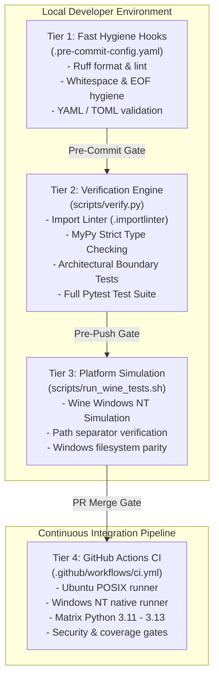

# ADR 0008: Scope and Boundary Enforcement Mechanisms

## Status

Accepted

## Context

`ed-schema` serves as the foundational contract governance, schema validation, and build-time code generation engine for the *Elite Dangerous* telemetry fleet, directly powering `ed-connectors` (unifying provider subpackages `capi`, `eddn`, `inara`, `spansh` under [RFC 0001](file:///home/michael/src/github.com/mnaatjes/ed-schema/architecture/rfcs/0001_fleet_unification_and_provider_subpackage_architecture.md)) and consumer applications. The Master Risk Register ([`risk-list.md`](file:///home/michael/src/github.com/mnaatjes/ed-schema/architecture/risk/risk-list.md)) identifies critical technical risks, including schema drift (`RISK-01`), namespace collisions (`RISK-02`), dynamic runtime code generation (`RISK-03`), domain logic leakage (`RISK-04`), network I/O boundary contamination (`RISK-05`), and cross-platform divergence (`RISK-08`).

Without rigid boundary definitions and automated, multi-tiered enforcement mechanisms, schema management libraries routinely degenerate into monolithic packages that conflate game-specific domain models, network transport protocols, secret credential management, and runtime evaluation hacks.

This ADR synthesizes the in-scope and out-of-scope architectural boundaries established across `UC-01` through `UC-04` and `ADR 0001` through `ADR 0007`, formalizing the automated enforcement harness across pre-commit hooks, static analysis, import boundary linters, AST verification tests, and continuous integration pipelines.

## Decision Drivers

* **Zero Game Domain Coupling:** Strict prohibition of *Elite Dangerous* game logic (commanders, ships, stars, journals, or commodities) within `ed-schema`.
* **Zero Network Transport Responsibility:** Absolute decoupling from HTTP dispatch, socket management, retries, and rate limiting (exclusively owned by `ed-transport`).
* **Deterministic Code Generation:** Build-time only compilation via AST models; zero runtime code evaluation (`eval()`, `exec()`, or dynamic `type()`).
* **Autonomous In-Process Verification:** Elimination of external schema fetch dependencies in consumer test harnesses.
* **Strict Hexagonal Boundary Isolation:** Enforced unidirectional dependency flow from adapters to domain core, with zero external adapter imports in core entities.
* **Cross-Platform Parity:** Guaranteed identical behavior across Linux (POSIX) and Windows NT (Wine/native).

## In-Scope vs. Out-of-Scope Boundary Specification

### System Boundary & Scope Enforcement Matrix

| Scope Item | Architectural Classification | Governing Use Case / ADR | Boundary Justification |
| :--- | :--- | :--- | :--- |
| **JSON Schema Ingestion & Indexing** | **IN-SCOPE** | `UC-01`, `ADR 0001` | Parses and indexes Draft-07/2020-12 schemas into a 4-tuple composite key registry `(namespace, endpoint, discriminator_field, discriminator_value)`. |
| **Build-Time Dataclass Compilation** | **IN-SCOPE** | `UC-02`, `ADR 0002` | Compiles JSON schemas into typed, frozen Python dataclasses with `__all__` lexical exports via `datamodel-code-generator`. |
| **AST Parity Verification** | **IN-SCOPE** | `UC-03`, `ADR 0003` | Validates in-memory synchronization between disk schemas and compiled dataclasses via AST inspection. |
| **Composite Pre-Flight Validation** | **IN-SCOPE** | `UC-04`, `ADR 0005` | Validates HTTP headers (presence, casing, regex) and serializable payloads before dispatch. |
| **Programmatic Engine Facade** | **IN-SCOPE** | `ADR 0006` | Provides `SchemaEngine` driving adapter unifying ingestion, compilation, parity, and validation. |
| **Game Domain Entities & Logics** | **OUT-OF-SCOPE** | `RISK-04`, `ADR 0004` | Forbidden from declaring or importing game concepts (ships, stars, journals). Owned by consumer packages or `ed-models`. |
| **HTTP Transport & Network Sockets** | **OUT-OF-SCOPE** | `RISK-05`, `ADR 0005` | Zero network dispatch, connection pooling, backoff retries, or socket management. Exclusively owned by `ed-transport`. |
| **Runtime Dynamic Code Generation** | **OUT-OF-SCOPE** | `RISK-03`, `ADR 0002` | Dynamic compilation (`eval()`, `exec()`, or runtime `type()` synthesis) is strictly forbidden. |
| **Secret Storage & Credential Injection** | **OUT-OF-SCOPE** | `ADR 0005` | Dynamic authorization headers, tokens, and secrets are resolved and injected by transport layers, not `ed-schema`. |
| **Daemon Services & Standalone CLI Apps**| **OUT-OF-SCOPE** | `ADR 0006`, `ADR 0007` | `ed-schema` is an embedded library and build-time toolsuite, not a standalone daemon or background service. |

### Environmental & Technical Boundaries Enforcement Matrix

| Risk ID | Identified Risk Description | Boundary Rule | Automated Enforcement Mechanism |
| :--- | :--- | :--- | :--- |
| **RISK-01** | Schema-Dataclass Parity Drift | Generated Python models must identically reflect JSON schemas. | AST parity engine (`SchemaEngine.verify_parity()`), enforced in `scripts/verify.py` and CI. |
| **RISK-02** | Multi-Namespace Identifier Collision | Models and schemas across disparate APIs must not collide. | 4-tuple composite key registry and isolated subdirectory package namespaces enforced in unit tests. |
| **RISK-03** | Dynamic Code Injection Vulnerability | No arbitrary string compilation at runtime. | AST banned-symbol test scanning for `eval`, `exec`, and dynamic `type` creation. |
| **RISK-04** | Domain Model Logic Creep | `ed-schema` must remain completely agnostic of game domain semantics. | Import linter rule banning `ed_models` + AST token check banning domain vocabulary in `src/`. |
| **RISK-05** | Network I/O Contamination | `ed-schema` must operate strictly in-memory and on local disk without network calls. | AST / socket inspection tests banning `requests`, `urllib`, `httpx`, `aiohttp`, and raw `socket`. |
| **RISK-06** | Lexical Scope Contamination | Global module namespaces must not expose internal generator artifacts. | Dataclass verification test asserting explicit `__all__` exports and scope hygiene. |
| **RISK-07** | Incomplete Pre-Flight Validation | Validation must fail early before payload transmission. | Unit test matrix executing `SchemaEngine.validate_call()` against missing headers and malformed bodies. |
| **RISK-08** | Cross-Platform Path Incompatibility | Path separators and schema resolution must function identically on POSIX and Windows NT. | Local Wine test runner (`scripts/run_wine_tests.sh`) and multi-OS GitHub Actions CI matrix. |
| **RISK-09** | Build-Time Pipeline Failure Cascades | Downstream packages must fail fast if schema generation is broken. | Standalone CLI exit code assertion (`ed-schema compile --check`) in build pipelines. |
| **RISK-10** | Schema Parsing Performance Degradation | Large payload validation must not induce unacceptable CPU or memory latency. | Schema compilation caching and benchmarking tests for validator engines. |

## Architectural Decision

We implement a 4-Tier Automated Boundary Enforcement Architecture to guarantee that all scope and boundary invariants are mechanically validated at commit, pre-flight, build, and CI stages.

### Tier 1: Local Pre-Commit Gate (`.pre-commit-config.yaml`)
Enforces immediate lexical, structural, and syntax hygiene in sub-second execution:
* `ruff` and `ruff-format` for PEP 8 conformance, modern Python syntax, and import sorting.
* Standard pre-commit hooks for trailing whitespace, end-of-file formatting, and YAML/TOML syntax integrity.

### Tier 2: Comprehensive In-Process Verification (`scripts/verify.py`)
Acts as the single authoritative pre-push verification script, executing:
1. **Import Boundary Linter (`.importlinter`):**
   * Verifies strict hexagonal layers: `domain` cannot import `ports`, `use_cases`, or `adapters`.
   * Enforces port decoupling: `ports` cannot import `adapters` or `use_cases`.
   * Prohibits forbidden external dependencies: zero imports of `ed_models`, `ed_transport`, `requests`, `httpx`, `aiohttp`, or `urllib`.
2. **Strict Static Type Checking (`mypy --strict`):**
   * Enforces 100% type annotations, disallowing untyped `Any`, missing returns, or implicit re-exports.
3. **Architectural AST & Boundary Tests (`tests/architecture/test_boundaries.py`):**
   * Inspects AST syntax trees across `src/ed_schema/` to guarantee zero calls to `eval()`, `exec()`, or runtime `compile()`.
   * Inspects module imports across `src/ed_schema/` to guarantee zero network socket or HTTP engine imports.
   * Asserts pure business-logic ignorance: scans domain AST for forbidden game domain tokens.
4. **Pytest Test Suite (`tests/`):**
   * Complete unit, integration, and parity test harness execution.

### Tier 3: Cross-Platform Wine Simulation (`scripts/run_wine_tests.sh`)
Executes the full test suite within a local Wine Windows NT prefix to verify path resolution (`pathlib.PureWindowsPath` vs `pathlib.PurePosixPath`), case-insensitive filesystem handling, and schema relative path resolution before pushing code.

### Tier 4: Continuous Integration Pipeline (`.github/workflows/ci.yml`)
Executes across a matrix of operating systems (Ubuntu POSIX and Windows NT native) and Python versions (3.11 through 3.13):
* Validates clean dependency installation from lockfiles.
* Executes `scripts/verify.py`.
* Verifies zero git working tree drift after running `ed-schema compile`.

## Consequences

### Positive
* **Deterministic Contract Integrity:** Zero risk of untested schema drift or runtime dynamic evaluation regressions.
* **Hermetic Boundary Isolation:** The domain core remains completely decoupled from external networking, game logic, and database systems.
* **Fast Feedback Loop:** Developers receive instant mechanical enforcement locally before code leaves their workstation.
* **Universal Reusability:** Downstream integration clients (`ed-connectors` and consuming telemetry applications) can rely unconditionally on static dataclasses and in-process validation without network dependencies.

### Negative / Trade-Offs
* **Build-Time Overhead:** Build-time generation and AST parity checks introduce additional milliseconds to verification pipelines.
* **Strict Development Discipline:** Adding new features requires adhering strictly to hexagonal port/adapter interfaces and passing AST boundary inspections.

## References

* [`architecture/risk/risk-list.md`](file:///home/michael/src/github.com/mnaatjes/ed-schema/architecture/risk/risk-list.md)
* [`architecture/use-cases/UC-01_load_manifests_and_register_schemas.md`](file:///home/michael/src/github.com/mnaatjes/ed-schema/architecture/use-cases/UC-01_load_manifests_and_register_schemas.md)
* [`architecture/use-cases/UC-02_compile_dataclass_models.md`](file:///home/michael/src/github.com/mnaatjes/ed-schema/architecture/use-cases/UC-02_compile_dataclass_models.md)
* [`architecture/use-cases/UC-03_verify_schema_parity.md`](file:///home/michael/src/github.com/mnaatjes/ed-schema/architecture/use-cases/UC-03_verify_schema_parity.md)
* [`architecture/use-cases/UC-04_validate_endpoint_pre_flight_contract.md`](file:///home/michael/src/github.com/mnaatjes/ed-schema/architecture/use-cases/UC-04_validate_endpoint_pre_flight_contract.md)
* [`architecture/adr/0001_multi_namespace_manifest_loading_and_composite_schema_registry.md`](file:///home/michael/src/github.com/mnaatjes/ed-schema/architecture/adr/0001_multi_namespace_manifest_loading_and_composite_schema_registry.md)
* [`architecture/adr/0006_programmatic_driving_adapter_facade_definition.md`](file:///home/michael/src/github.com/mnaatjes/ed-schema/architecture/adr/0006_programmatic_driving_adapter_facade_definition.md)
* [`architecture/adr/0007_consumer_build_pipeline_and_parity_test_harness_patterns.md`](file:///home/michael/src/github.com/mnaatjes/ed-schema/architecture/adr/0007_consumer_build_pipeline_and_parity_test_harness_patterns.md)
