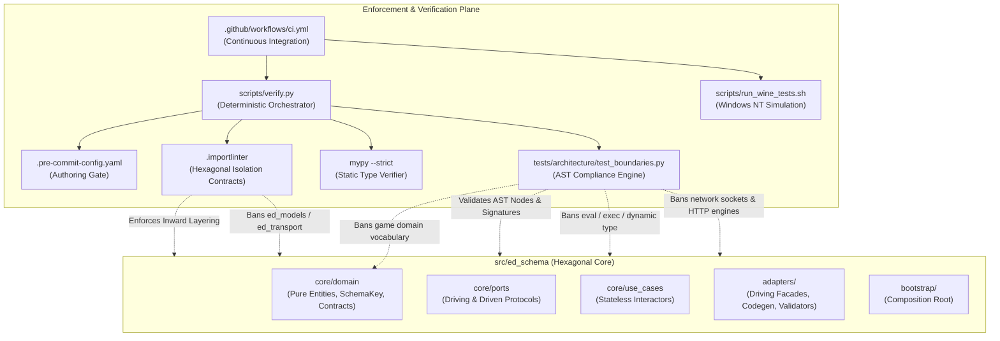
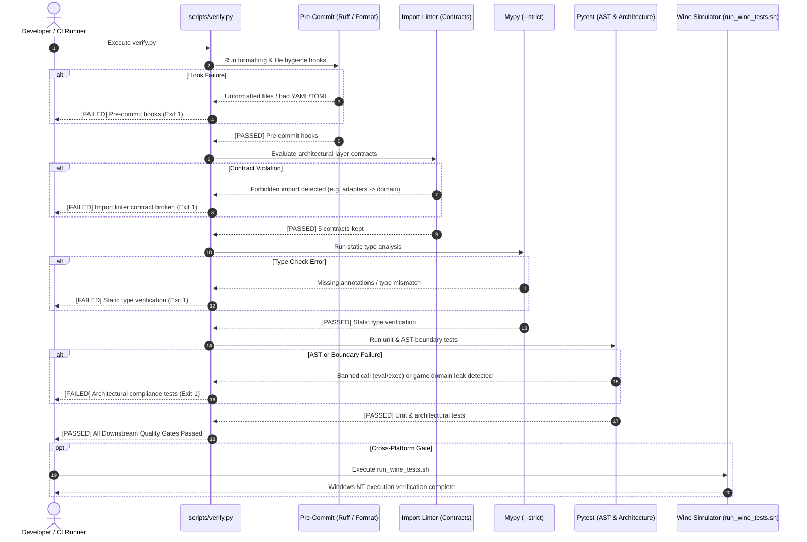

# SDD-001: Scope and Boundary Enforcement Architecture

## 1. Introduction and Architectural Motivation

### 1.1 Scope and Objective
This Software Design Document (SDD) specifies the structural architecture, component contracts, AST inspection engine, and multi-tier verification pipelines that deterministically enforce the scope boundaries and architectural constraints of `ed-schema`. It acts as the direct implementation design for [ADR 0008: Scope and Boundary Enforcement Mechanisms](file:///home/michael/src/github.com/mnaatjes/ed-schema/architecture/adr/0008_scope_and_boundary_enforcement_mechanisms.md), systematically translating the requirements of `UC-01` through `UC-04` and the Environmental and Technical boundaries of the Master Risk Register ([`risk-list.md`](file:///home/michael/src/github.com/mnaatjes/ed-schema/architecture/risk/risk-list.md)) into executable quality gates.

### 1.2 The Skeptic Test (Why Build Automated Boundary Enforcement?)
In a distributed telemetry architecture where `ed-schema` serves as the contract and build-time compilation backbone for `ed-connectors` (unifying provider subpackages `capi`, `eddn`, `inara`, `spansh` under [RFC 0001](file:///home/michael/src/github.com/mnaatjes/ed-schema/architecture/rfcs/0001_fleet_unification_and_provider_subpackage_architecture.md)), boundary leakage poses severe operational risks:
1. **Accidental Domain Model Infiltration (`RISK-04`):** Without automated guards, developers writing schema utilities or code generators will naturally import game models from `ed-models` or define Elite Dangerous domain entities (commanders, ships, journals, commodities) directly inside `ed-schema`. This tightly couples contract tooling to game releases.
2. **Network I/O Boundary Contamination (`RISK-05`):** Allowing HTTP clients (`requests`, `httpx`, `aiohttp`, `urllib`) or raw sockets into schema validation or code generation introduces network latency, external downtime risks, and credential leaks into pure in-process verification pipelines.
3. **Dynamic Runtime Code Injection (`RISK-03`):** Using dynamic evaluation shortcuts (`eval()`, `exec()`, or dynamic runtime `type()` synthesis) introduces severe security vulnerabilities, defeats static type checkers, and breaks PyInstaller/cx_Freeze frozen binaries.
4. **Silent Schema-Dataclass Drift (`RISK-01`):** Manual code reviews reliably fail to catch subtle attribute mismatches between JSON schemas on disk and generated Python dataclasses.
5. **Cross-Platform Path Discrepancies (`RISK-08`):** Windows NT path separators (`\`) and case-insensitive file systems behave differently than POSIX platforms; unverified code causes silent test and compilation failures on native Windows and Steam Deck Proton runtimes.

Informal conventions and documentation fail under delivery pressure. Enforcing architectural boundaries at compile, lint, and AST verification time mathematically eliminates these failure modes before code merges to `main`.

### 1.3 The Vacation Test
This specification details the AST inspection visitors, import-linter contracts, pre-commit hooks, Wine test runner execution, and verification orchestrators with sufficient technical precision that an independent engineer could completely implement, execute, and extend these enforcement mechanisms without consulting the original author.

---

## 2. Visual Architecture Models

### 2.1 Structural Component Model



### 2.2 Dynamic Verification Flow Model



---

## 3. Subsystem Detailed Design

### 3.1 Tier 1: Local Pre-Commit Authoring Gate (`.pre-commit-config.yaml`)

#### Component Contract
The pre-commit configuration operates as a sub-second local authoring guard. It intercepts git commits before code is staged to remote branches.

#### Managed Hooks
1. `trailing-whitespace`: Strips superfluous line-end whitespace.
2. `end-of-file-fixer`: Ensures clean POSIX trailing newlines.
3. `check-yaml` / `check-toml`: Verifies valid syntax across configuration and manifests.
4. `ruff`: Enforces strict lint rules (Pyflakes, pycodestyle, isort, flake8-bugbear, pep8-naming).
5. `ruff-format`: Enforces deterministic black-compatible code formatting.

---

### 3.2 Tier 2: In-Process Verification Engine (`scripts/verify.py`)

#### Component Contract
`scripts/verify.py` is the single authoritative local and CI quality gate. It executes in four distinct phases, terminating immediately with an exit code of `1` upon the first phase failure.

```python
# scripts/verify.py execution phase contract
def run_quality_gates() -> int:
    steps = [
        ("Pre-commit hooks", run_pre_commit),
        ("Import linter boundary contracts", run_import_linter),
        ("Static type verification", run_mypy),
        ("Unit and architectural compliance tests", run_pytest),
    ]
    for label, step_fn in steps:
        rc = step_fn()
        if rc != 0:
            return 1
    return 0
```

#### 3.2.1 Import Linter Contract Architecture (`.importlinter`)
The import linter defines 5 contracts isolating the hexagonal layers and external boundaries:
1. `core_domain_isolation`: Forbids `core.domain` from importing `core.ports`, `core.use_cases`, or `adapters`.
2. `inward_dependency_direction`: Forbids `core.ports` and `core.use_cases` from importing `adapters`.
3. `domain_port_isolation`: Forbids `core.domain` from importing outer infrastructure libraries.
4. `use_case_transport_isolation`: Forbids `core.use_cases` from importing network dispatchers or CLI adapters.
5. `composition_root_isolation`: Confines concrete adapter instantiation to `bootstrap/`.

Additionally, an explicit contract bans imports of `ed_models`, `ed_transport`, `requests`, `httpx`, `aiohttp`, and `urllib` across all of `src/ed_schema/`.

#### 3.2.2 AST Compliance Engine (`tests/architecture/test_boundaries.py`)
The architectural test suite parses the Python Abstract Syntax Tree (AST) of the repository to enforce invariants that linters cannot express:

1. **Banned Function Call Visitor (`BannedCallVisitor`):**
   * Traverses AST `Call` nodes across all Python files in `src/ed_schema/`.
   * Flags and asserts failure if any call matches `eval`, `exec`, or `compile` (mitigating `RISK-03`).

```python
class BannedCallVisitor(ast.NodeVisitor):
    BANNED_FUNCTIONS = {"eval", "exec", "compile"}

    def __init__(self, filename: str) -> None:
        self.filename = filename
        self.violations: list[str] = []

    def visit_Call(self, node: ast.Call) -> None:
        if isinstance(node.func, ast.Name) and node.func.id in self.BANNED_FUNCTIONS:
            self.violations.append(
                f"{self.filename}:{node.lineno} calls banned dynamic function '{node.func.id}'"
            )
        self.generic_visit(node)
```

2. **Network I/O and Socket Import Banning (`test_zero_network_io_in_library`):**
   * Scans all `Import` and `ImportFrom` nodes across `src/ed_schema/`.
   * Banned modules: `socket`, `http`, `urllib`, `requests`, `httpx`, `aiohttp`, `websocket`.
   * Ensures `ed-schema` remains an entirely local, in-memory/disk contract processor (mitigating `RISK-05`).

3. **Game Domain Vocabulary Isolation (`test_zero_game_domain_leakage`):**
   * Scans class names, function names, and variable names in `src/ed_schema/core/domain/`.
   * Banned tokens: `Commander`, `Ship`, `StarSystem`, `Journal`, `Commodity`, `Station`, `Market`.
   * Guarantees absolute business-logic ignorance (mitigating `RISK-04`).

4. **Self-Validating Domain Entities (`test_domain_entities_are_self_validating`):**
   * Inspects `src/ed_schema/core/domain/` entity classes (`SchemaKey`, `SchemaDescriptor`, `EndpointContract`, `HeaderParameterContract`).
   * Asserts that entities are frozen (`@dataclass(frozen=True)`) and contain `__post_init__` validation.

---

### 3.3 Tier 3: Cross-Platform Wine Simulation (`scripts/run_wine_tests.sh`)

#### Component Contract
Validates that file path resolution, manifest indexing, and code generation execute without divergence on Windows NT.

```bash
#!/usr/bin/env bash
set -euo pipefail

export WINEPREFIX="${HOME}/.wine"
export WINEDEBUG="-all"

wine python.exe -m pytest tests/
```

* Asserts that schema paths defined with forward slashes (`/`) correctly resolve when run under Windows NT backslash semantics (`\`).
* Asserts case-preservation and case-insensitivity handling across Windows drives (`Z:\home\...`).

---

### 3.4 Tier 4: Continuous Integration Pipeline (`.github/workflows/ci.yml`)

#### Component Contract
The CI workflow executes on every pull request and push to `main` across a multi-platform matrix:
* **Operating Systems:** `ubuntu-latest`, `windows-latest`.
* **Python Matrix:** `3.11`, `3.12`, `3.13`.
* **Validation Steps:**
  1. Checkout repository and set up Python.
  2. Cache virtual environment dependencies.
  3. Execute `.venv/bin/python scripts/verify.py`.
  4. Execute programmatic compile verification: `python -m ed_schema compile --check`.
  5. Assert zero uncommitted git drift (`git diff --exit-code`).

---

## 4. Implementation Phasing and PR Sequencing

| Milestone | Target Scope | Core Deliverables | Verification Quality Gate |
| :--- | :--- | :--- | :--- |
| **Phase 1: Governance & Documentation** *(Active)* | UP Elaboration Artifacts | `risk-list.md`, `UC-01`–`UC-04`, `ADR 0008`, `SDD-001` | Lint and frontmatter validation, PR review. |
| **Phase 2: Core Domain & Ports** | Pure Entities & SPIs | `SchemaKey`, `SchemaDescriptor`, `CompositeSchemaRegistry`, driving/driven port Protocols | `pytest tests/architecture/test_boundaries.py` passes 100%. Zero adapter imports. |
| **Phase 3: AST Parity & Codegen Adapters** | Concrete Adapters & Interactors | `SchemaEngine`, `DatamodelCodeGeneratorAdapter`, `AstParityChecker` | Full unit test suite passes with AST compliance checks. |
| **Phase 4: Pre-Flight Validation Engine** | Header & Body Validation | `ValidatePayloadUseCase`, Header regex rules, JSON schema validator adapter | Pre-flight validation tests pass with zero network imports. |
| **Phase 5: Cross-Platform & CI Hardening** | Automation Harness | Wine test runner, Windows native CI matrix, verify script | Matrix CI passes across Ubuntu and Windows on Python 3.11–3.13. |

---

## 5. Architectural Quality Attributes & Non-Functional Requirements

* **Performance:** Pre-commit hooks execute in $<1.5\text{s}$. The full `verify.py` suite executes in $<15\text{s}$ locally.
* **Hermetic Execution:** `tests/` executes with zero outbound network calls and zero mocked HTTP sockets.
* **Deterministic Code Generation:** AST parity verification guarantees identical code generation output across Linux and Windows NT without whitespace or line-break variance.
* **Fail-Fast Semantics:** Any boundary violation, banned import, or dynamic code execution immediately halts the verification pipeline with actionable error diagnostics.

---

## 6. References

* [ADR 0008: Scope and Boundary Enforcement Mechanisms](file:///home/michael/src/github.com/mnaatjes/ed-schema/architecture/adr/0008_scope_and_boundary_enforcement_mechanisms.md)
* [ADR 0001: Multi-Namespace Manifest Loading and Composite Schema Registry](file:///home/michael/src/github.com/mnaatjes/ed-schema/architecture/adr/0001_multi_namespace_manifest_loading_and_composite_schema_registry.md)
* [ADR 0004: DTO Naming Conventions and Lexical Scope Isolation](file:///home/michael/src/github.com/mnaatjes/ed-schema/architecture/adr/0004_dto_naming_conventions_and_lexical_scope_isolation.md)
* [RFC 0001: Fleet Unification via ed-connectors Microkernel](file:///home/michael/src/github.com/mnaatjes/ed-schema/architecture/rfcs/0001_fleet_unification_and_provider_subpackage_architecture.md)
* [Master Risk Register (`risk-list.md`)](file:///home/michael/src/github.com/mnaatjes/ed-schema/architecture/risk/risk-list.md)
* [IEEE 1016-2009: Systems Design — Software Design Descriptions](https://ieeexplore.ieee.org/document/5167266)
