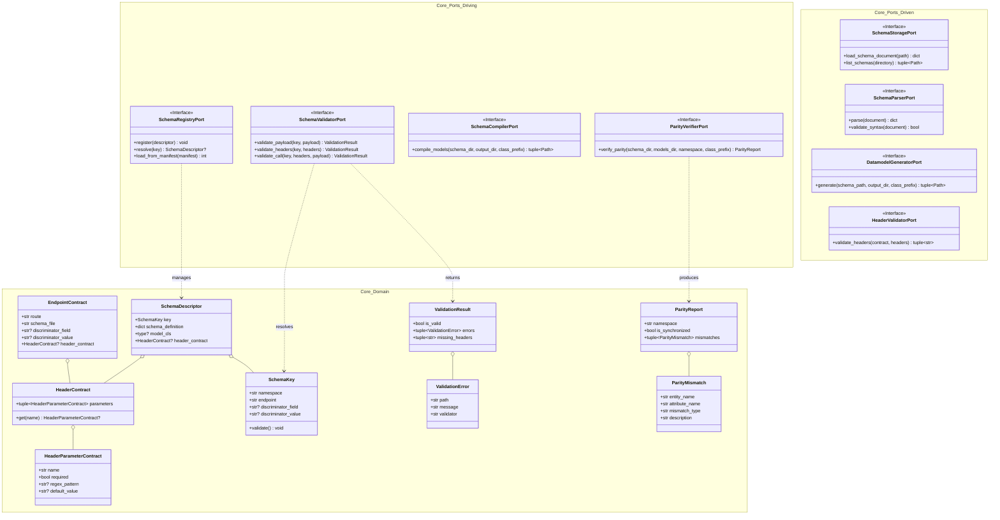
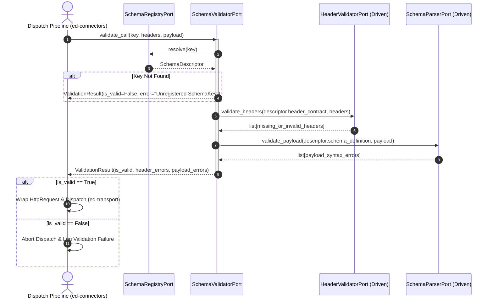

# SDD-002: Core Domain and Ports Architecture

## 1. Introduction and Architectural Motivation

### 1.1 Scope and Objective
This Software Design Document (SDD) defines the comprehensive structural architecture, class contracts, domain models, value objects, exceptions, and abstract port interfaces (`core/domain/` and `core/ports/`) for `ed-schema`. It synthesizes all foundational specifications established across ADRs 0001 through 0008 and RUP Use Cases `UC-01` through `UC-04` into a cohesive, implementation-ready design.

### 1.2 The Skeptic Test (Why Pure Domain and Port Decoupling?)
In schema processing and code generation libraries, domain models are frequently contaminated by third-party parser ASTs (e.g. `genson`, `datamodel-code-generator`, or `fastjsonschema`). Coupling the core to external compiler tools creates three fatal architectural flaws:
1. **Upstream Library Lock-In (`RISK-07`):** When `datamodel-code-generator` or `jsonschema` changes its internal AST representation or validation exceptions, un-isolated application code breaks across consumer services.
2. **Game Domain Contamination (`RISK-04`):** Allowing Elite Dangerous concepts (commanders, journals, ships) into contract definitions couples the schema engine to game updates.
3. **Immutability and Concurrency Failures:** Shared mutable registries cause race conditions under high-throughput multi-threaded telemetry dispatching on Linux and Windows NT runtimes.

Establishing pure, frozen domain dataclasses and abstract port protocols guarantees complete isolation from external frameworks, enabling deterministic in-memory resolution with zero I/O side effects.

### 1.3 The Vacation Test
This document details every domain dataclass attribute, port method signature, type annotation, and validation guard with sufficient precision that an independent software engineer could implement `src/ed_schema/core/` and its complete unit test harness without consultation.

---

## 2. Visual Architecture Models

### 2.1 Structural Domain & Ports Model



### 2.2 Dynamic Pre-Flight Validation & Dispatch Flow



---

## 3. Subsystem Detailed Design

### 3.1 Domain Models and Value Objects (`core/domain/`)

All domain entities are declared as frozen, self-validating dataclasses (`@dataclass(frozen=True)`).

#### 3.1.1 Composite Identifier: `SchemaKey`
*Governing ADR: ADR 0001, ADR 0004*
Represents the universal 4-tuple composite key indexing any API contract across the fleet.

```python
@dataclass(frozen=True)
class SchemaKey:
    namespace: str
    endpoint: str
    discriminator_field: str | None = None
    discriminator_value: str | None = None

    def __post_init__(self) -> None:
        if not self.namespace or not self.namespace.strip():
            raise ValueError("SchemaKey 'namespace' must be a non-empty string.")
        if not self.endpoint or not self.endpoint.strip():
            raise ValueError("SchemaKey 'endpoint' must be a non-empty string.")
        if not self.endpoint.startswith("/"):
            raise ValueError(
                f"SchemaKey 'endpoint' must begin with '/': {self.endpoint}"
            )
        if (self.discriminator_field is None) ^ (
            self.discriminator_value is None
        ):
            raise ValueError(
                "SchemaKey discriminator_field and discriminator_value must both be set or both be None."
            )
```

#### 3.1.2 Header Parameter Contract: `HeaderParameterContract` & `HeaderContract`
*Governing ADR: ADR 0005*
Models HTTP headers with case-insensitive normalization and optional regex/requirement rules.

```python
@dataclass(frozen=True)
class HeaderParameterContract:
    name: str
    required: bool = True
    regex_pattern: str | None = None
    default_value: str | None = None

    def __post_init__(self) -> None:
        if not self.name or not self.name.strip():
            raise ValueError("HeaderParameterContract 'name' cannot be empty.")
        object.__setattr__(self, "name", self.name.lower().strip())


@dataclass(frozen=True)
class HeaderContract:
    parameters: tuple[HeaderParameterContract, ...] = ()

    def get(self, name: str) -> HeaderParameterContract | None:
        normalized = name.lower().strip()
        for param in self.parameters:
            if param.name == normalized:
                return param
        return None
```

#### 3.1.3 Endpoint Contract: `EndpointContract`
*Governing ADR: ADR 0001, ADR 0005*
Declares an endpoint mapping within a provider manifest.

```python
@dataclass(frozen=True)
class EndpointContract:
    route: str
    schema_file: str
    discriminator_field: str | None = None
    discriminator_value: str | None = None
    header_contract: HeaderContract | None = None

    def __post_init__(self) -> None:
        if not self.route or not self.route.startswith("/"):
            raise ValueError(
                f"EndpointContract 'route' must start with '/': {self.route}"
            )
        if not self.schema_file or not self.schema_file.endswith(".json"):
            raise ValueError(
                f"EndpointContract 'schema_file' must be a .json file: {self.schema_file}"
            )
```

#### 3.1.4 Contract Bundle: `SchemaDescriptor`
*Governing ADR: ADR 0001, ADR 0005, ADR 0006*
Bundles the identity, parsed schema, optional compiled DTO model class, and header contract.

```python
@dataclass(frozen=True)
class SchemaDescriptor:
    key: SchemaKey
    schema_definition: dict[str, Any]
    model_cls: type | None = None
    header_contract: HeaderContract | None = None

    def __post_init__(self) -> None:
        if not isinstance(self.schema_definition, dict):
            raise TypeError("SchemaDescriptor 'schema_definition' must be a dict.")
```

#### 3.1.5 Validation Output: `ValidationResult` & `ValidationError`
*Governing ADR: ADR 0005, ADR 0006*
Represents immutable pre-flight validation status.

```python
@dataclass(frozen=True)
class ValidationError:
    path: str
    message: str
    validator: str


@dataclass(frozen=True)
class ValidationResult:
    is_valid: bool
    payload_errors: tuple[ValidationError, ...] = ()
    header_errors: tuple[str, ...] = ()

    @property
    def has_errors(self) -> bool:
        return not self.is_valid or bool(self.payload_errors or self.header_errors)
```

#### 3.1.6 Parity Verification: `ParityReport` & `ParityMismatch`
*Governing ADR: ADR 0003, ADR 0007*
Details AST synchronization status between on-disk schemas and compiled models.

```python
@dataclass(frozen=True)
class ParityMismatch:
    entity_name: str
    attribute_name: str
    mismatch_type: str  # "MISSING_FIELD", "TYPE_MISMATCH", "EXTRA_FIELD"
    description: str


@dataclass(frozen=True)
class ParityReport:
    namespace: str
    is_synchronized: bool
    mismatches: tuple[ParityMismatch, ...] = ()
```

---

### 3.2 Domain Exceptions (`core/domain/exceptions.py`)

All exceptions inherit from a common base `DomainError` ensuring technology-agnostic isolation.

```python
class DomainError(Exception):
    """Base domain exception for ed-schema."""


class SchemaRegistrationError(DomainError):
    """Raised when registering an invalid or colliding SchemaKey."""


class ContractViolationError(DomainError):
    """Raised when pre-flight validation fails prior to network dispatch."""


class SchemaParityError(DomainError):
    """Raised when on-disk models diverge from canonical JSON schemas."""


class SchemaCompilationError(DomainError):
    """Raised when build-time code generation encounters fatal syntax errors."""
```

---

### 3.3 Abstract Boundary Contracts (`core/ports/`)

All ports inherit from `typing.Protocol` or `abc.ABC` and operate strictly on pure domain entities and primitives.

#### 3.3.1 Driving Ports (`core/ports/driving/`)

1. **`SchemaRegistryPort`:** Manages registration and resolution of composite contracts.
   ```python
   class SchemaRegistryPort(Protocol):
       def register(self, descriptor: SchemaDescriptor) -> None: ...
       def resolve(self, key: SchemaKey) -> SchemaDescriptor | None: ...
       def load_from_manifests(self, manifests: Sequence[Any]) -> int: ...
```

2. **`SchemaValidatorPort`:** Pre-flight validation gate for payload bodies and HTTP headers.
   ```python
   class SchemaValidatorPort(Protocol):
       def validate_payload(
           self, key: SchemaKey, payload: dict[str, Any]
       ) -> ValidationResult: ...
       def validate_headers(
           self, key: SchemaKey, headers: Mapping[str, str]
       ) -> ValidationResult: ...
       def validate_call(
           self,
           key: SchemaKey,
           headers: Mapping[str, str],
           payload: dict[str, Any] | None = None,
       ) -> ValidationResult: ...
```

3. **`SchemaCompilerPort`:** Build-time dataclass compilation.
   ```python
   class SchemaCompilerPort(Protocol):
       def compile_models(
           self,
           schema_dir: Path,
           output_dir: Path,
           class_prefix: str,
       ) -> tuple[Path, ...]: ...
```

4. **`ParityVerifierPort`:** AST parity verification engine.
   ```python
   class ParityVerifierPort(Protocol):
       def verify_parity(
           self,
           schema_dir: Path,
           models_dir: Path,
           namespace: str,
           class_prefix: str,
       ) -> ParityReport: ...
```

#### 3.3.2 Driven Ports (`core/ports/driven/`)

1. **`SchemaStoragePort`:** Filesystem access for schema files.
   ```python
   class SchemaStoragePort(Protocol):
       def read_schema_file(self, file_path: Path) -> dict[str, Any]: ...
       def list_schema_files(self, schema_dir: Path) -> tuple[Path, ...]: ...
```

2. **`SchemaParserPort`:** JSON Schema parsing and validation engine adapter SPI.
   ```python
   class SchemaParserPort(Protocol):
       def validate_payload(
           self, schema_definition: dict[str, Any], payload: dict[str, Any]
       ) -> tuple[ValidationError, ...]: ...
```

3. **`DatamodelGeneratorPort`:** Code generator engine SPI.
   ```python
   class DatamodelGeneratorPort(Protocol):
       def generate_dataclasses(
           self,
           schema_path: Path,
           output_file: Path,
           class_prefix: str,
       ) -> None: ...
```

4. **`HeaderValidatorPort`:** Header contract verification adapter SPI.
   ```python
   class HeaderValidatorPort(Protocol):
       def validate_headers(
           self, contract: HeaderContract, headers: Mapping[str, str]
       ) -> tuple[str, ...]: ...
```

---

## 4. Implementation Phasing and PR Sequencing

| Milestone | Target Scope | Core Deliverables | Quality Gate |
| :--- | :--- | :--- | :--- |
| **Milestone 1: Domain Entities & Value Objects** | `src/ed_schema/core/domain/` | `SchemaKey`, `HeaderContract`, `EndpointContract`, `SchemaDescriptor`, `ValidationResult`, `ParityReport` | 100% frozen entity immutability, `__post_init__` checks, and AST domain vocabulary test passing. |
| **Milestone 2: Domain Exceptions** | `src/ed_schema/core/domain/exceptions.py` | `DomainError` hierarchy | `pytest tests/architecture/test_boundaries.py` inherits from base error. |
| **Milestone 3: Driving & Driven Ports** | `src/ed_schema/core/ports/` | `SchemaRegistryPort`, `SchemaValidatorPort`, `SchemaCompilerPort`, `ParityVerifierPort`, and SPIs | Protocol inheritance checks and AST purity checks passing. |
| **Milestone 4: Core Unit Test Suite** | `tests/unit/core/` | Unit tests for all entities, value objects, and exception handling | Pytest 100% branch coverage across `core/`. |

---

## 5. Architectural Quality Attributes & Invariants

* **Zero External Dependencies:** `core/domain` and `core/ports` import standard library modules only (`dataclasses`, `typing`, `pathlib`, `re`, `abc`).
* **Immutability:** Every domain model is decorated with `@dataclass(frozen=True)` and uses immutable collection primitives (`tuple`, `Mapping`).
* **Fast In-Memory Resolution:** Hashing on `SchemaKey` enables $O(1)$ dictionary lookups without disk or network latency.
* **Hermetic Boundary Compliance:** Passes all 6 `.importlinter` contracts and all 32 architectural compliance AST checks.

---

## 6. References

* [ADR 0001: Multi-Namespace Manifest Loading and Composite Schema Registry](file:///home/michael/src/github.com/mnaatjes/ed-schema/architecture/adr/0001_multi_namespace_manifest_loading_and_composite_schema_registry.md)
* [ADR 0002: Programmatic Build-Time Dataclass Compilation](file:///home/michael/src/github.com/mnaatjes/ed-schema/architecture/adr/0002_programmatic_build_time_dataclass_compilation.md)
* [ADR 0003: Granular In-Process Parity Verification](file:///home/michael/src/github.com/mnaatjes/ed-schema/architecture/adr/0003_granular_in_process_parity_verification.md)
* [ADR 0004: DTO Naming Conventions and Lexical Scope Isolation](file:///home/michael/src/github.com/mnaatjes/ed-schema/architecture/adr/0004_dto_naming_conventions_and_lexical_scope_isolation.md)
* [ADR 0005: Composite Pre-Flight Endpoint and Header Contract Validation](file:///home/michael/src/github.com/mnaatjes/ed-schema/architecture/adr/0005_composite_pre_flight_endpoint_and_header_contract_validation.md)
* [ADR 0006: Programmatic Driving Adapter Facade Definition](file:///home/michael/src/github.com/mnaatjes/ed-schema/architecture/adr/0006_programmatic_driving_adapter_facade_definition.md)
* [ADR 0007: Consumer Build Pipeline and Parity Test Harness Patterns](file:///home/michael/src/github.com/mnaatjes/ed-schema/architecture/adr/0007_consumer_build_pipeline_and_parity_test_harness_patterns.md)
* [ADR 0008: Scope and Boundary Enforcement Mechanisms](file:///home/michael/src/github.com/mnaatjes/ed-schema/architecture/adr/0008_scope_and_boundary_enforcement_mechanisms.md)
* [RFC 0001: Fleet Unification via ed-connectors Microkernel](file:///home/michael/src/github.com/mnaatjes/ed-schema/architecture/rfcs/0001_fleet_unification_and_provider_subpackage_architecture.md)
* [IEEE 1016-2009: Systems Design — Software Design Descriptions](https://ieeexplore.ieee.org/document/5167266)
