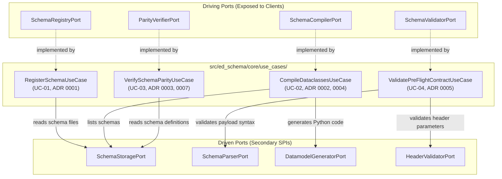
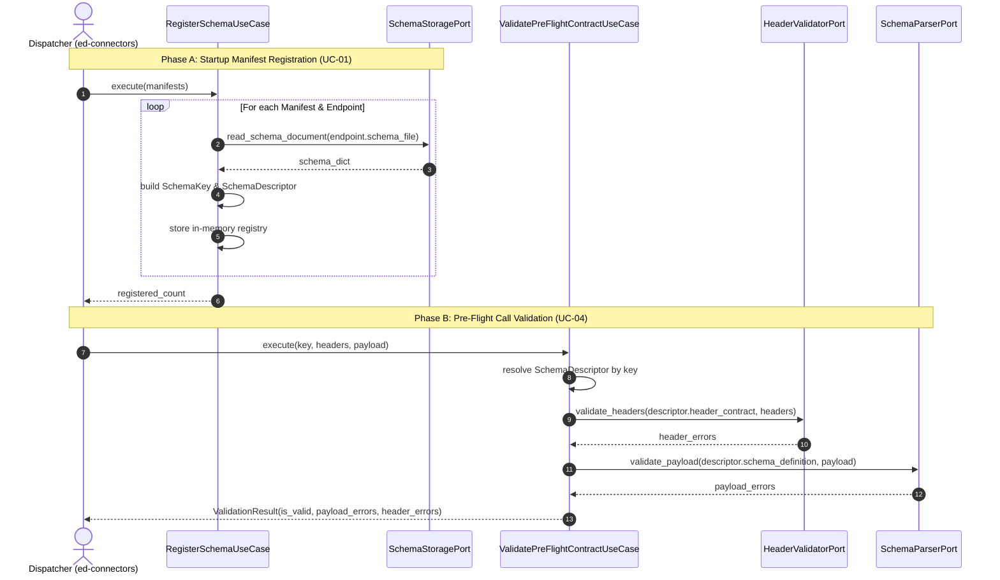

# SDD-003: Core Use Cases and Interactors Architecture

## 1. Introduction and Architectural Motivation

### 1.1 Scope and Objective
This Software Design Document (SDD) defines the stateless interactor architecture (`src/ed_schema/core/use_cases/`) for `ed-schema`. It translates the operational requirements from the Unified Process Use Case specifications (`UC-01` through `UC-04`) and Architectural Decision Records (`ADR 0001` through `ADR 0008`) into four isolated, testable, and dependency-injected use case interactors.

### 1.2 The Skeptic Test (Why Isolated Interactors?)
In contract validation and code generation libraries, business rules and workflow orchestration are frequently merged into a giant monolithic client class or scattered across CLI scripts:
1. **Tight Coupling to Concrete Parsers (`RISK-07`):** When code generation or schema parsing logic is embedded directly inside API dispatch routines, switching or upgrading parsing engines breaks consumers.
2. **Untestable Side Effects:** Direct filesystem operations or network calls inside orchestration logic defeat fast, in-memory automated unit testing.
3. **State Contamination Across Requests:** Stateful interactors that store mutable state in `self` cause race conditions and data bleeding under concurrent multi-threaded telemetry streaming.

Confining orchestration to pure, stateless interactors that depend strictly on abstract driven ports (`core/ports/driven/`) guarantees that each use case can be executed and unit-tested in microsecond test loops using in-memory doubles (`tests/doubles/`).

### 1.3 The Vacation Test
This document details every interactor's constructor dependencies, execution signatures, domain model transformations, error handling rules, and boundary constraints with sufficient precision that an independent engineer could implement and test the complete `core/use_cases/` package without consultation.

---

## 2. Visual Architecture Models

### 2.1 Component Interaction Model



### 2.2 Sequence Diagram: Ingestion and Pre-Flight Flow



---

## 3. Subsystem Detailed Design

### 3.1 Architectural Invariants & Boundary Rules
In accordance with `tests/architecture/test_boundaries.py`:
1. **Imperative Verb Naming:** Every interactor class name must start with an approved imperative verb (`Register...`, `Compile...`, `Verify...`, `Validate...`) and end with `UseCase`.
2. **Constructor Dependency Injection:** All dependencies (driven ports, registries) must be injected via `__init__`.
3. **Stateless Execution:** Interactors must never mutate `self` attributes during execution methods (`execute()`).
4. **Zero Adapter Imports:** Interactors must never import `src/ed_schema/adapters/`, `requests`, `httpx`, or external frameworks.
5. **Pure Domain Types:** Method arguments and return types must be pure domain dataclasses (`SchemaKey`, `ValidationResult`, `ParityReport`), primitives, or standard library paths.

---

### 3.2 Interactor Specifications

#### 3.2.1 `RegisterSchemaUseCase`
*Governing References: `UC-01`, `ADR 0001`, `ADR 0006`*

* **Primary Purpose:** Ingests provider manifests, loads on-disk schema files via `SchemaStoragePort`, pairs them with endpoint contracts into `SchemaDescriptor` objects, and indexes them in the in-memory registry.
* **Constructor Dependencies:**
  * `storage: SchemaStoragePort`: Reads raw JSON schema documents from disk.
* **Method Signature:**
  ```python
  class RegisterSchemaUseCase:
      def __init__(self, storage: SchemaStoragePort) -> None:
          self._storage = storage
          self._registry: dict[SchemaKey, SchemaDescriptor] = {}

      def register(self, descriptor: SchemaDescriptor) -> None:
          """Registers an explicit SchemaDescriptor."""
          ...

      def resolve(self, key: SchemaKey) -> SchemaDescriptor | None:
          """Resolves a SchemaDescriptor by SchemaKey in O(1) time."""
          ...

      def execute(self, manifests: Sequence[Any]) -> int:
          """Loads all endpoint contracts across provider manifests into registry."""
          ...
  ```
* **Failure Modes & Exception Handling:**
  * If a manifest schema path cannot be found, raises `SchemaRegistrationError`.
  * If two endpoints register the identical 4-tuple `SchemaKey`, raises `SchemaRegistrationError` with duplicate key details.

---

#### 3.2.2 `CompileDataclassesUseCase`
*Governing References: `UC-02`, `ADR 0002`, `ADR 0004`, `ADR 0007`*

* **Primary Purpose:** Programmatically compiles JSON Schemas into typed, frozen Python dataclasses with provider-prefixed class names and strict lexical scope exports (`__all__`).
* **Constructor Dependencies:**
  * `storage: SchemaStoragePort`: Discovers schema files on disk.
  * `generator: DatamodelGeneratorPort`: Invokes the code generation engine.
* **Method Signature:**
  ```python
  class CompileDataclassesUseCase:
      def __init__(
          self,
          storage: SchemaStoragePort,
          generator: DatamodelGeneratorPort,
      ) -> None:
          self._storage = storage
          self._generator = generator

      def execute(
          self,
          schema_dir: Path,
          output_dir: Path,
          class_prefix: str,
      ) -> tuple[Path, ...]:
          """Discovers schemas and generates Python dataclasses."""
          ...
  ```
* **Failure Modes & Exception Handling:**
  * If `schema_dir` does not exist or contains invalid schemas, raises `SchemaCompilationError`.
  * Guarantees output files define explicit `__all__` symbols.

---

#### 3.2.3 `VerifySchemaParityUseCase`
*Governing References: `UC-03`, `ADR 0003`, `ADR 0007`*

* **Primary Purpose:** Inspects AST equivalence between on-disk JSON Schemas and compiled Python models, ensuring no uncommitted schema drift occurs.
* **Constructor Dependencies:**
  * `storage: SchemaStoragePort`: Reads canonical schema files.
* **Method Signature:**
  ```python
  class VerifySchemaParityUseCase:
      def __init__(self, storage: SchemaStoragePort) -> None:
          self._storage = storage

      def execute(
          self,
          schema_dir: Path,
          models_dir: Path,
          namespace: str,
          class_prefix: str,
      ) -> ParityReport:
          """Performs AST parity inspection and produces ParityReport."""
          ...
  ```
* **Failure Modes & Exception Handling:**
  * If structural differences exist (missing fields, type mismatches), populates `ParityReport.mismatches` with `is_synchronized=False`.
  * If files cannot be parsed, raises `SchemaParityError`.

---

#### 3.2.4 `ValidatePreFlightContractUseCase`
*Governing References: `UC-04`, `ADR 0005`, `ADR 0006`*

* **Primary Purpose:** Executes unified pre-flight validation on outgoing HTTP headers and payload bodies before transmission.
* **Constructor Dependencies:**
  * `registry_resolver: Callable[[SchemaKey], SchemaDescriptor | None]`: Resolves active descriptor.
  * `header_validator: HeaderValidatorPort`: Verifies HTTP headers against contract regex/requirements.
  * `schema_parser: SchemaParserPort`: Validates payload JSON against schema rules.
* **Method Signature:**
  ```python
  class ValidatePreFlightContractUseCase:
      def __init__(
          self,
          registry_resolver: Callable[[SchemaKey], SchemaDescriptor | None],
          header_validator: HeaderValidatorPort,
          schema_parser: SchemaParserPort,
      ) -> None:
          self._registry_resolver = registry_resolver
          self._header_validator = header_validator
          self._schema_parser = schema_parser

      def execute(
          self,
          key: SchemaKey,
          headers: Mapping[str, str],
          payload: dict[str, Any] | None = None,
      ) -> ValidationResult:
          """Validates headers and payload, returning composite ValidationResult."""
          ...
  ```
* **Failure Modes & Exception Handling:**
  * If `key` is unregistered, returns `ValidationResult(is_valid=False, header_errors=("Unregistered SchemaKey",))`.
  * Returns complete list of violations without throwing runtime exceptions for standard payload validation mismatches.

---

## 4. Implementation Phasing and PR Sequencing

| Milestone | Target Scope | Core Deliverables | Verification Quality Gate |
| :--- | :--- | :--- | :--- |
| **Milestone 1: Use Case Implementations** | `src/ed_schema/core/use_cases/` | `RegisterSchemaUseCase`, `CompileDataclassesUseCase`, `VerifySchemaParityUseCase`, `ValidatePreFlightContractUseCase` | Pass `test_use_cases_follow_lexical_and_structural_conventions`, `test_use_cases_are_stateless_interactors`. |
| **Milestone 2: Unit Test Suite** | `tests/unit/core/use_cases/` | Exhaustive tests for all 4 interactors using in-memory doubles from `tests/doubles/` | 100% statement and branch coverage in `use_cases/`. |
| **Milestone 3: Quality Gate Verification** | Full repository verification | Execution of `scripts/verify.py` | Pre-commit, import linter (6 contracts), static typing (mypy --strict), pytest. |

---

## 5. Architectural Quality Attributes & Non-Functional Requirements

* **Determinism & Hermeticity:** Zero network socket calls, subprocess executions, or filesystem writes outside designated output directories.
* **Performance:** Use case execution runs in $<1\text{ms}$ for in-memory descriptor lookups and payload validation.
* **Statelessness:** Interactor instances can be shared safely across concurrent threads.

---

## 6. References

* [ADR 0001: Multi-Namespace Manifest Loading and Composite Schema Registry](file:///home/michael/src/github.com/mnaatjes/ed-schema/architecture/adr/0001_multi_namespace_manifest_loading_and_composite_schema_registry.md)
* [ADR 0002: Programmatic Build-Time Dataclass Compilation](file:///home/michael/src/github.com/mnaatjes/ed-schema/architecture/adr/0002_programmatic_build_time_dataclass_compilation.md)
* [ADR 0003: Granular In-Process Parity Verification](file:///home/michael/src/github.com/mnaatjes/ed-schema/architecture/adr/0003_granular_in_process_parity_verification.md)
* [ADR 0004: DTO Naming Conventions and Lexical Scope Isolation](file:///home/michael/src/github.com/mnaatjes/ed-schema/architecture/adr/0004_dto_naming_conventions_and_lexical_scope_isolation.md)
* [ADR 0005: Composite Pre-Flight Endpoint and Header Contract Validation](file:///home/michael/src/github.com/mnaatjes/ed-schema/architecture/adr/0005_composite_pre_flight_endpoint_and_header_contract_validation.md)
* [ADR 0006: Programmatic Driving Adapter Facade Definition](file:///home/michael/src/github.com/mnaatjes/ed-schema/architecture/adr/0006_programmatic_driving_adapter_facade_definition.md)
* [ADR 0007: Consumer Build Pipeline and Parity Test Harness Patterns](file:///home/michael/src/github.com/mnaatjes/ed-schema/architecture/adr/0007_consumer_build_pipeline_and_parity_test_harness_patterns.md)
* [ADR 0008: Scope and Boundary Enforcement Mechanisms](file:///home/michael/src/github.com/mnaatjes/ed-schema/architecture/adr/0008_scope_and_boundary_enforcement_mechanisms.md)
* [RFC 0001: Fleet Unification via ed-connectors Microkernel](file:///home/michael/src/github.com/mnaatjes/ed-schema/architecture/rfcs/0001_fleet_unification_and_provider_subpackage_architecture.md)
* [UC-01: Load Manifests and Register Schemas](file:///home/michael/src/github.com/mnaatjes/ed-schema/architecture/use-cases/UC-01_load_manifests_and_register_schemas.md)
* [UC-02: Compile Dataclass Models](file:///home/michael/src/github.com/mnaatjes/ed-schema/architecture/use-cases/UC-02_compile_dataclass_models.md)
* [UC-03: Verify Schema Parity](file:///home/michael/src/github.com/mnaatjes/ed-schema/architecture/use-cases/UC-03_verify_schema_parity.md)
* [UC-04: Validate Endpoint Pre-Flight Contract](file:///home/michael/src/github.com/mnaatjes/ed-schema/architecture/use-cases/UC-04_validate_endpoint_pre_flight_contract.md)
* [IEEE 1016-2009: Systems Design — Software Design Descriptions](https://ieeexplore.ieee.org/document/5167266)
