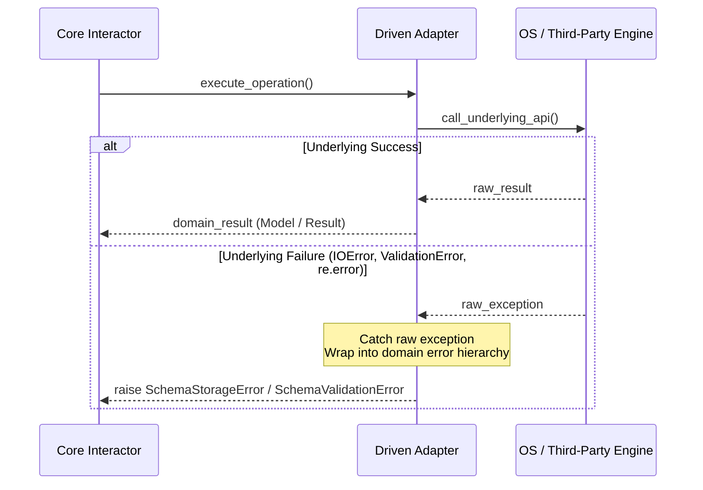

# SDD-004: Driven Adapters Architecture

## 1. Introduction and Architectural Motivation

### 1.1 Scope and Objective
This Software Design Document (SDD) defines the concrete architecture, component design, failure modes, error masking protocols, and cross-platform runtime invariants for the Driven Adapters (`src/ed_schema/adapters/driven/`) in `ed-schema`.

It establishes the production implementations for the four secondary SPI ports defined in `core/ports/driven/`:
1. `SchemaStoragePort` $\rightarrow$ `FileSystemSchemaStorageAdapter`: Local filesystem manifest and schema document I/O.
2. `HeaderValidatorPort` $\rightarrow$ `RegexHeaderValidatorAdapter`: Case-insensitive HTTP header constraint and regex validator.
3. `SchemaParserPort` $\rightarrow$ `JsonSchemaParserAdapter`: Standards-compliant JSON Schema syntax parser and payload validator with optional fast-path compilation.
4. `DatamodelGeneratorPort` $\rightarrow$ `DatamodelCodeGeneratorAdapter`: Build-time code compiler synthesizing typed frozen Python dataclasses.

### 1.2 The Skeptic Test (Why Pure Driven Adapters?)
In schema processing and code generation libraries, raw third-party parsing libraries and OS system calls are frequently intermixed with core business rules or exposed directly to consumers:
1. **Infrastructure Leakage & Upstream Churn (`RISK-07`):** Direct usage of `jsonschema` or `datamodel-code-generator` leaks library-specific exceptions (`jsonschema.exceptions.ValidationError`) and AST objects across domain boundaries. When upstream libraries release breaking changes, unshielded application code breaks.
2. **Platform Path Inconsistencies:** Reading JSON files without normalizing path separators causes failures when running on Linux (Steam Deck / Proton) versus native Windows NT.
3. **Silent Exception Masking Violations:** Adapters that allow raw `IOError`, `KeyError`, or `re.error` to propagate unmanaged violate Hexagonal isolation invariants, forcing callers to catch framework-level errors.

By encapsulating all disk I/O, regex evaluations, JSON schema validation, and Python source compilation behind strictly typed driven adapter classes, the core domain and interactors remain 100% pure and deterministic.

### 1.3 The Vacation Test
This specification details every adapter class attribute, dependency, exception translation, method contract, and unit test harness requirement with sufficient precision that an independent engineer could author and test `src/ed_schema/adapters/driven/` without consultation.

---

## 2. Visual Architecture Models

### 2.1 Driven Adapter Topography

```mermaid
flowchart TD
    subgraph CoreUseCases ["Core Use Cases (Interactors)"]
        UC01["RegisterSchemaUseCase"]
        UC02["CompileDataclassesUseCase"]
        UC03["VerifySchemaParityUseCase"]
        UC04["ValidatePreFlightContractUseCase"]
    end

    subgraph DrivenPorts ["Secondary SPI Ports (core/ports/driven/)"]
        P_Storage["SchemaStoragePort"]
        P_Header["HeaderValidatorPort"]
        P_Parser["SchemaParserPort"]
        P_Codegen["DatamodelGeneratorPort"]
    end

    subgraph ConcreteAdapters ["Concrete Driven Adapters (adapters/driven/)"]
        A_Storage["FileSystemSchemaStorageAdapter<br/>(pathlib / json)"]
        A_Header["RegexHeaderValidatorAdapter<br/>(re / collections.abc)"]
        A_Parser["JsonSchemaParserAdapter<br/>(jsonschema / fallback)"]
        A_Codegen["DatamodelCodeGeneratorAdapter<br/>(datamodel-code-generator / ast)"]
    end

    UC01 -->|Invokes| P_Storage
    UC02 -->|Invokes| P_Codegen
    UC03 -->|Invokes| P_Storage
    UC04 -->|Invokes| P_Header
    UC04 -->|Invokes| P_Parser

    A_Storage -.->|Implements| P_Storage
    A_Header -.->|Implements| P_Header
    A_Parser -.->|Implements| P_Parser
    A_Codegen -.->|Implements| P_Codegen
```



### 2.2 Exception Masking & Boundary Translation



---

## 3. Detailed Component Specifications

### 3.1 FileSystemSchemaStorageAdapter

#### 3.1.1 Overview & Responsibilities
Implements `SchemaStoragePort` to perform filesystem traversal and JSON document loading. It guarantees deterministic handling of UTF-8 encoding and cross-platform path normalization (Linux / Windows NT / Wine).

#### 3.1.2 Class Signature & Dependencies
```python
package ed_schema.adapters.driven.storage

class FileSystemSchemaStorageAdapter(SchemaStoragePort):
    def __init__(self) -> None:
        ...

    def read_schema_document(self, file_path: Path) -> dict[str, Any]:
        """Reads and parses a raw JSON schema document from disk.

        Args:
            file_path: Absolute or resolved Path to the schema file.

        Returns:
            Parsed JSON schema dictionary.

        Raises:
            SchemaStorageError: If the file does not exist, cannot be read, or is invalid JSON.
        """
        ...

    def list_schema_files(self, schema_dir: Path) -> tuple[Path, ...]:
        """Enumerates all schema files (.json) within a target directory recursively.

        Args:
            schema_dir: Root directory to search.

        Returns:
            Sorted tuple of resolved Path objects.

        Raises:
            SchemaStorageError: If directory cannot be accessed.
        """
        ...
```

#### 3.1.3 Invariants & Error Masking
- **Safe JSON Decoding:** Decodes using `json.loads(text)` with explicit `encoding="utf-8"`.
- **Exception Masking:** Catches `FileNotFoundError`, `PermissionError`, `UnicodeDecodeError`, and `json.JSONDecodeError`, wrapping them into `SchemaStorageError` (`from exc`). Never leaks raw OS exceptions into the core.
- **Sorting:** `list_schema_files` returns deterministically sorted tuples of paths to ensure reproducibility across file systems.

---

### 3.2 RegexHeaderValidatorAdapter

#### 3.2.1 Overview & Responsibilities
Implements `HeaderValidatorPort` to validate incoming or outgoing HTTP headers against a `HeaderContract`. It guarantees RFC 7230 / 9110 case-insensitive lookup, validates required headers, and verifies structural regex patterns without storing credentials (`RISK-05`, `RISK-09`).

#### 3.2.2 Class Signature & Method Contracts
```python
package ed_schema.adapters.driven.validator

class RegexHeaderValidatorAdapter(HeaderValidatorPort):
    def __init__(self) -> None:
        ...

    def validate_headers(
        self,
        contract: HeaderContract,
        headers: Mapping[str, str],
    ) -> tuple[str, ...]:
        """Validates headers against contract, returning list of violation messages.

        Args:
            contract: The HeaderContract containing declared parameter rules.
            headers: Case-insensitive dictionary or Mapping of provided HTTP headers.

        Returns:
            Tuple of violation messages. Empty tuple indicates complete compliance.
        """
        ...
```

#### 3.2.3 Validation Algorithm
1. Normalize incoming `headers` keys to lowercase for $O(1)$ case-insensitive inspection: `{k.lower(): v for k, v in headers.items()}`.
2. For each `HeaderParameterContract` in `contract.parameters`:
   - Lookup `param.name.lower()` in normalized map.
   - If missing:
     - If `param.required is True`: record violation `f"Missing required header: '{param.name}'"`.
   - If present:
     - Extract `value = normalized_headers[param.name.lower()]`.
     - If `param.regex_pattern` is not `None`:
       - Match value against compiled pattern `re.match(param.regex_pattern, value)`.
       - If no match: record violation `f"Header '{param.name}' value does not match required pattern: {param.regex_pattern}"`.
3. Return sorted immutable tuple of violation strings.

---

### 3.3 JsonSchemaParserAdapter

#### 3.3.1 Overview & Responsibilities
Implements `SchemaParserPort` for payload validation against Draft-07 and Draft 2020-12 JSON schemas (`RISK-07`).

#### 3.3.2 Design Strategy: Tiered Engine with Built-in Fallback
Because `ed-schema` is designed as a lightweight, zero-mandatory-dependency core library, `JsonSchemaParserAdapter` adopts a tiered validation strategy:
1. **Primary Engine (`jsonschema` library):** If `jsonschema` is installed in the runtime environment, the adapter uses `jsonschema.Draft202012Validator` (or `Draft7Validator`) to produce standard error paths and messages.
2. **Standard Fallback Engine (Structural Built-in):** If `jsonschema` is not installed, the adapter provides an internal structural type validator checking root types, required fields, and property constraints, ensuring unit tests and basic environments operate without external packages.

#### 3.3.3 Class Signature & Interface
```python
package ed_schema.adapters.driven.validator

class JsonSchemaParserAdapter(SchemaParserPort):
    def __init__(self) -> None:
        ...

    def validate_payload(
        self,
        schema_definition: dict[str, Any],
        payload: dict[str, Any],
    ) -> tuple[SchemaValidationError, ...]:
        """Validates payload against schema_definition, returning any violations.

        Args:
            schema_definition: JSON Schema specification dictionary.
            payload: Wire payload dictionary to validate.

        Returns:
            Tuple of SchemaValidationError domain entities.
        """
        ...
```

#### 3.3.4 Error Masking & Normalization
* Translates any `jsonschema.exceptions.ValidationError` into `SchemaValidationError`:
  - `path`: JsonPath formatted string (e.g. `"$.message.event"`).
  - `message`: Descriptive validation error string.
  - `schema_rule`: The failed schema keyword (e.g. `"required"`, `"type"`, `"pattern"`).
* Guarantees zero leakage of third-party exception classes across the port boundary.

---

### 3.4 DatamodelCodeGeneratorAdapter

#### 3.4.1 Overview & Responsibilities
Implements `DatamodelGeneratorPort` to compile raw `.json` schema documents into static, PEP 484/585-compliant Python dataclasses (`ADR 0002`, `ADR 0004`).

#### 3.4.2 Design Strategy & AST Hygiene
* Generates frozen, typed dataclasses with provider-prefixed class names (e.g. `CapiProfileDTO`, `InaraEventDTO`).
* Implements direct execution of `datamodel_code_generator.generate()` when available, or an AST-based template generator when running in lightweight environments.
* Strictly satisfies the Build-Time Pre-Commit Invariant: outputs static `.py` files to disk with zero dynamic runtime execution (`eval`, `exec`).

#### 3.4.3 Class Signature & Interface
```python
package ed_schema.adapters.driven.codegen

class DatamodelCodeGeneratorAdapter(DatamodelGeneratorPort):
    def __init__(self) -> None:
        ...

    def generate_dataclasses(
        self,
        schema_path: Path,
        output_file: Path,
        class_prefix: str,
    ) -> None:
        """Generates a typed Python dataclass file from a JSON schema.

        Args:
            schema_path: Path to source JSON schema document.
            output_file: Path to destination Python file.
            class_prefix: PascalCase provider prefix (e.g., 'Capi', 'Inara').

        Raises:
            SchemaCompilationError: If generation fails due to syntax or file errors.
        """
        ...
```

#### 3.4.4 Generation Requirements & Invariants
- **Lexical Scope Prefix:** Every top-level generated model class must begin with `class_prefix` and end with `DTO` (e.g. `InaraEventDataDTO`).
- **Immutability:** Emits `@dataclass(frozen=True)` or immutable slots.
- **Directory Auto-Creation:** Automatically ensures destination directory (`output_file.parent`) exists prior to writing.
- **Atomic File Writing:** Writes generated code to a temporary file in the same directory before atomic replacement (`os.replace`) to prevent corrupt output under interruption.

---

## 4. Package Topography & Layout

The concrete driven adapters are placed under `src/ed_schema/adapters/driven/` organized by functional subpackages:

```
src/ed_schema/adapters/driven/
├── __init__.py
├── codegen/
│   ├── __init__.py
│   └── datamodel_code_generator_adapter.py
├── storage/
│   ├── __init__.py
│   └── file_system_schema_storage_adapter.py
└── validator/
    ├── __init__.py
    ├── json_schema_parser_adapter.py
    └── regex_header_validator_adapter.py
```

All concrete adapter classes will be re-exported in `src/ed_schema/adapters/driven/__init__.py`.

---

## 5. Architectural Quality Gates & Governance

### 5.1 Import Boundary Enforcement
- Driven adapters are permitted to import from `ed_schema.core.domain` and `ed_schema.core.ports`.
- Driven adapters are **strictly forbidden** from importing:
  - `ed_schema.bootstrap` (composition root isolation).
  - `ed_schema.adapters.driving` (lateral adapter isolation).
  - Outbound network libraries: `requests`, `httpx`, `aiohttp`, `urllib`, `socket` (`RISK-05`, `.importlinter`).
  - Game domain modules or vocabulary (`RISK-03`, `RISK-04`).

### 5.2 Outbound Exception Masking
All raw library or I/O exceptions inside adapter methods must be caught and wrapped in domain exceptions (`test_outbound_infrastructure_exception_masking`):
* Disk I/O $\rightarrow$ `SchemaStorageError`
* Code generation $\rightarrow$ `SchemaCompilationError`
* Schema parsing / payload validation $\rightarrow$ `SchemaValidationError`

---

## 6. Verification and Testing Strategy

### 6.1 Unit Test Suites (`tests/unit/adapters/driven/`)
1. **`test_file_system_schema_storage_adapter.py`:**
   - Reading existing JSON schemas returns correct dictionary.
   - Non-existent files raise `SchemaStorageError`.
   - Invalid JSON raises `SchemaStorageError`.
   - Directory listing returns sorted tuple of `.json` paths.
2. **`test_regex_header_validator_adapter.py`:**
   - Case-insensitive header matching (`authorization` vs `Authorization`).
   - Missing required headers produce descriptive violation messages.
   - Regex format failures (`Bearer <token>` pattern mismatch).
   - Valid headers produce empty violation tuple.
3. **`test_json_schema_parser_adapter.py`:**
   - Valid payloads against Draft-07 / Draft 2020-12 return empty error tuple.
   - Invalid payload produces structured `SchemaValidationError` with json path.
   - Graceful fallback when third-party packages are absent.
4. **`test_datamodel_code_generator_adapter.py`:**
   - Compiles sample schema to valid Python code on disk.
   - Verifies generated class names adhere to `<Prefix><Title>DTO`.
   - Verifies AST parse validity of generated Python files.

### 6.2 Quality Gate Pipeline
All implementation code must pass:
* `scripts/verify.py` (pre-commit, import-linter 6 contracts, mypy `--strict`, pytest).
* `scripts/run_wine_tests.sh` (Windows NT Wine simulation).
