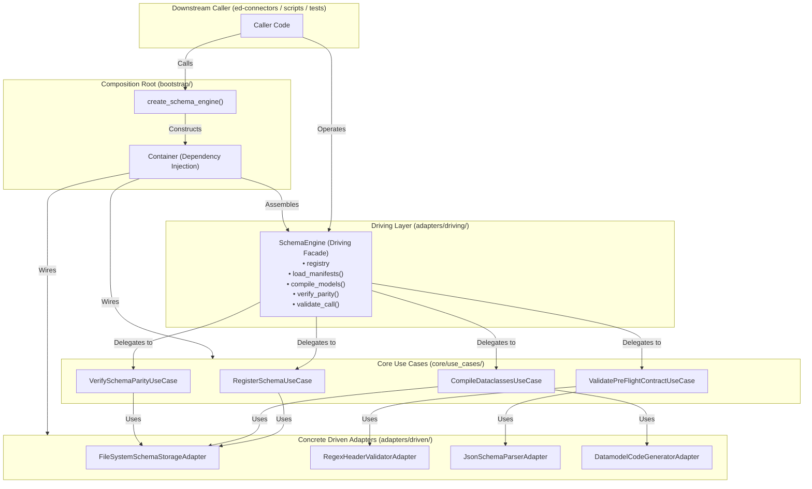

# SDD-005: Composition Root and Driving Facade Architecture

## 1. Introduction and Architectural Motivation

### 1.1 Scope and Objective
This Software Design Document (SDD) defines the architecture, component design, dependency injection mechanics, and public API surface for the **Driving Adapter Facade (`SchemaEngine`)** and **Composition Root (`Container` / `create_schema_engine`)** within `ed-schema`.

It realizes the operational mandate defined in [ADR 0006](file:///home/michael/src/github.com/mnaatjes/ed-schema/architecture/adr/0006_programmatic_driving_adapter_facade_definition.md) and aligns with the sibling library patterns established in `ed-transport`:
1. **Composition Root (`src/ed_schema/bootstrap/`):** Instantiates concrete driven adapters, wires them into stateless use cases, and encapsulates dependency lifecycle management.
2. **Driving Facade (`src/ed_schema/adapters/driving/schema_engine.py`):** Provides a single, unified, ergonomic client API (`SchemaEngine`) wrapping the underlying driving ports (`SchemaRegistryPort`, `SchemaValidatorPort`, `SchemaCompilerPort`, `ParityVerifierPort`).
3. **Public Package Interface (`src/ed_schema/__init__.py`):** Exposes `SchemaEngine`, `create_schema_engine`, and canonical domain types as the clean boundary contract consumed by downstream applications (`ed-connectors`, `ed-telemetry`).

### 1.2 The Skeptic Test (Why a Dedicated Facade and Composition Root?)
In hexagonal software systems, libraries often suffer from two divergent extremes:
1. **Direct Use Case Proliferation:** Callers are forced to manually construct five different adapters and instantiate four use cases just to validate an HTTP header or compile a schema.
2. **Framework Monolith Contamination:** A monolithic client class embeds file I/O, regex matching, AST walking, and validation logic into a single 2,000-line class, destroying port/adapter testability.

A pure driving adapter facade (`SchemaEngine`) delegating strictly to isolated driving ports and interactors provides the best of both worlds: zero-boilerplate ergonomics for client authors alongside strict, auditable architectural decoupling.

### 1.3 The Vacation Test
This specification details constructor dependencies, method signatures, default factory parameters, lifecycle invariants, and end-to-end integration test scenarios with sufficient precision that an independent engineer could author and test `src/ed_schema/bootstrap/` and `src/ed_schema/adapters/driving/schema_engine.py` without consultation.

---

## 2. Visual Architecture Models

### 2.1 Complete Hexagonal Wiring



---

## 3. Detailed Component Specifications

### 3.1 The Composition Root (`src/ed_schema/bootstrap/`)

#### 3.1.1 `Container` Class
The `Container` is the central dependency injection assembly point. It isolates adapter instantiation and guarantees that every dependency conforms to its respective Port interface (`HEXA-TRUTH-05`).

```python
package ed_schema.bootstrap.container

class Container:
    """Dependency injection container and composition root for ed-schema."""

    def __init__(
        self,
        storage_adapter: SchemaStoragePort | None = None,
        header_validator: HeaderValidatorPort | None = None,
        schema_parser: SchemaParserPort | None = None,
        code_generator: DatamodelGeneratorPort | None = None,
    ) -> None:
        self._storage = storage_adapter or FileSystemSchemaStorageAdapter()
        self._header_validator = header_validator or RegexHeaderValidatorAdapter()
        self._schema_parser = schema_parser or JsonSchemaParserAdapter()
        self._code_generator = code_generator or DatamodelCodeGeneratorAdapter()

    # Driven Adapter Resolvers
    def resolve_storage(self) -> SchemaStoragePort: ...
    def resolve_header_validator(self) -> HeaderValidatorPort: ...
    def resolve_schema_parser(self) -> SchemaParserPort: ...
    def resolve_code_generator(self) -> DatamodelGeneratorPort: ...

    # Interactor Resolvers
    def build_register_schema_use_case(self) -> RegisterSchemaUseCase: ...
    def build_compile_dataclasses_use_case(self) -> CompileDataclassesUseCase: ...
    def build_verify_schema_parity_use_case(self) -> VerifySchemaParityUseCase: ...
    def build_validate_pre_flight_contract_use_case(
        self,
        registry_resolver: Callable[[SchemaKey], SchemaDescriptor | None],
    ) -> ValidatePreFlightContractUseCase: ...

    # Driving Facade Builder
    def build_schema_engine(self) -> SchemaEngine: ...
```

#### 3.1.2 Factory Function: `create_schema_engine`
Provides a clean, functional instantiation hook with optional adapter overrides (e.g. for injecting custom storage or test doubles):

```python
def create_schema_engine(
    *,
    storage_adapter: SchemaStoragePort | None = None,
    header_validator: HeaderValidatorPort | None = None,
    schema_parser: SchemaParserPort | None = None,
    code_generator: DatamodelGeneratorPort | None = None,
) -> SchemaEngine:
    """Creates a fully configured, production-ready SchemaEngine facade."""
```

---

### 3.2 The Driving Adapter Facade (`SchemaEngine`)

#### 3.2.1 Architectural Role & Boundary Compliance
* **File Location:** `src/ed_schema/adapters/driving/schema_engine.py`.
* **Contract Delegation:** Delegates strictly to the injected use cases without implementing low-level business rules or filesystem I/O directly.
* **Driving Port Invariant (`HEXA-TRUTH-12`):** `SchemaEngine` does not declare inheritance from `DrivingPort` protocols in its class definition (satisfying `test_driving_ports_directional_integrity_and_exclusivity`), but structurally conforms to the operations required by `SchemaRegistryPort`, `SchemaValidatorPort`, `SchemaCompilerPort`, and `ParityVerifierPort`.

#### 3.2.2 Class Signature and Operations
```python
package ed_schema.adapters.driving.schema_engine

class SchemaEngine:
    """Primary programmatic driving facade for ed-schema."""

    def __init__(
        self,
        register_use_case: RegisterSchemaUseCase,
        validate_use_case: ValidatePreFlightContractUseCase,
        compile_use_case: CompileDataclassesUseCase,
        parity_use_case: VerifySchemaParityUseCase,
    ) -> None:
        self._register_uc = register_use_case
        self._validate_uc = validate_use_case
        self._compile_uc = compile_use_case
        self._parity_uc = parity_use_case

    # 1. Registry & Manifest Management (ADR 0001, UC-01)
    def register_descriptor(self, descriptor: SchemaDescriptor) -> None:
        """Stores a schema descriptor in the registry."""
        self._register_uc.register(descriptor)

    def resolve_descriptor(self, key: SchemaKey) -> SchemaDescriptor | None:
        """Resolves a registered schema descriptor in microseconds."""
        return self._register_uc.resolve(key)

    def load_manifests(self, manifests: Sequence[Any]) -> int:
        """Batch loads schemas across provider manifest declarations."""
        return self._register_uc.execute(manifests)

    # 2. Build-Time Code Generation (ADR 0002, ADR 0004, UC-02)
    def compile_models(
        self,
        schema_dir: str | Path,
        output_dir: str | Path,
        class_prefix: str,
    ) -> tuple[Path, ...]:
        """Compiles canonical JSON schemas into typed Python dataclasses."""
        return self._compile_uc.execute(
            schema_dir=Path(schema_dir),
            output_dir=Path(output_dir),
            class_prefix=class_prefix,
        )

    # 3. In-Process Parity Verification (ADR 0003, ADR 0007, UC-03)
    def verify_parity(
        self,
        schema_dir: str | Path,
        models_dir: str | Path,
        namespace: str,
        class_prefix: str,
    ) -> ParityReport:
        """Verifies structural AST equivalence between schemas and models."""
        return self._parity_uc.execute(
            schema_dir=Path(schema_dir),
            models_dir=Path(models_dir),
            namespace=namespace,
            class_prefix=class_prefix,
        )

    # 4. Composite Pre-Flight Validation (ADR 0005, UC-04)
    def validate_call(
        self,
        key: SchemaKey,
        headers: Mapping[str, str],
        payload: dict[str, Any] | None = None,
    ) -> ValidationResult:
        """Unified pre-flight validation gate verifying both headers and payload."""
        return self._validate_uc.execute(
            key=key,
            headers=headers,
            payload=payload,
        )
```

---

### 3.3 Public Package Boundary (`src/ed_schema/__init__.py`)

The top-level `__init__.py` provides consumer applications with single-import convenience:

```python
from ed_schema.adapters.driving.schema_engine import SchemaEngine
from ed_schema.bootstrap.client_factory import create_schema_engine
from ed_schema.core.domain.exceptions import (
    ContractViolationError,
    DomainError,
    DomainValidationError,
    SchemaCompilationError,
    SchemaParityError,
    SchemaRegistrationError,
    SchemaStorageError,
)
from ed_schema.core.domain.models import (
    EndpointContract,
    HeaderContract,
    HeaderParameterContract,
    ParityMismatch,
    ParityReport,
    SchemaDescriptor,
    SchemaKey,
    SchemaValidationError,
    ValidationResult,
)

__version__ = "0.1.0"

__all__ = (
    "ContractViolationError",
    "DomainError",
    "DomainValidationError",
    "EndpointContract",
    "HeaderContract",
    "HeaderParameterContract",
    "ParityMismatch",
    "ParityReport",
    "SchemaCompilationError",
    "SchemaDescriptor",
    "SchemaEngine",
    "SchemaKey",
    "SchemaParityError",
    "SchemaRegistrationError",
    "SchemaStorageError",
    "SchemaValidationError",
    "ValidationResult",
    "__version__",
    "create_schema_engine",
)
```

---

## 4. Verification and Testing Strategy

### 4.1 Unit Tests (`tests/unit/adapters/driving/` and `tests/unit/bootstrap/`)
1. **`test_schema_engine.py`:** Verifies delegation of all `SchemaEngine` methods to use cases using test doubles.
2. **`test_container.py`:** Verifies that default and custom adapter resolutions instantiate correct port-compliant objects.
3. **`test_client_factory.py`:** Verifies that `create_schema_engine()` yields an operational `SchemaEngine`.

### 4.2 End-to-End Integration Tests (`tests/integration/`)
1. **`test_schema_engine_e2e.py`:**
   - Manifest definition with sample schema on disk.
   - Batch loading via `engine.load_manifests()`.
   - Key resolution and pre-flight validation via `engine.validate_call()`.
   - Dataclass compilation via `engine.compile_models()`.
   - In-process parity verification via `engine.verify_parity()`.
