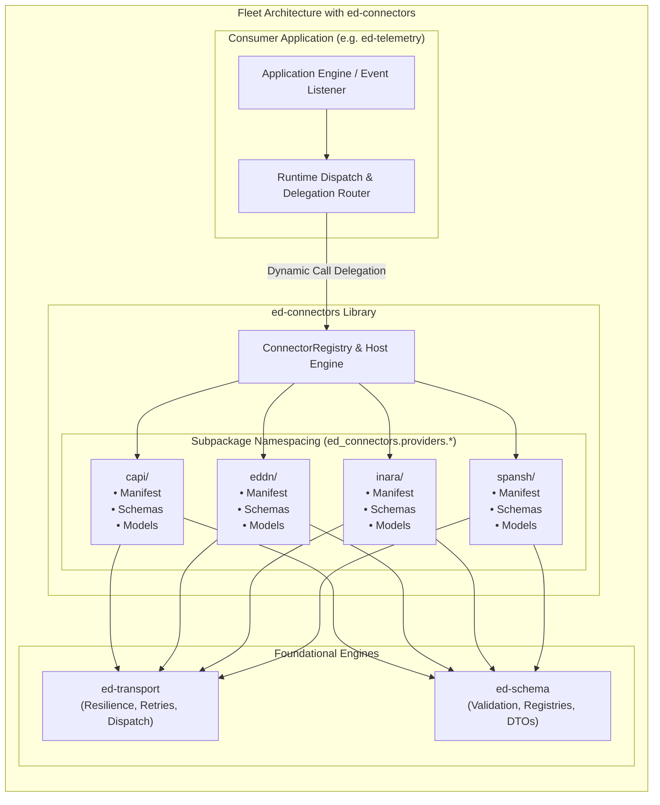

# RFC 0001: Fleet Unification via ed-connectors Microkernel and ed-schema Integration Pipeline

## 1. Summary

This RFC proposes unifying the planned bespoke Elite Dangerous integration client packages (`ed-capi`, `ed-eddn`, `ed-inara`) into a single, cohesive integration library: **`ed-connectors`**.

By leveraging the foundational abstractions established in **`ed-transport`** (resilient HTTP wire dispatch, token buckets, and jittered retries) and **`ed-schema`** (canonical JSON Schema management, 4-tuple composite key indexing, abstract HTTP header modeling, and build-time Python dataclass compilation), individual API client implementations are reduced to lightweight, declarative configuration manifests and schema definitions. `ed-connectors` adopts a **Microkernel / Plugin Architecture** utilizing **Subpackage Namespacing** (`ed_connectors.providers.<target>`) and co-located schema packaging to deliver modularity, version-locked compatibility, and dynamic runtime event delegation with minimal repository overhead.

---

## 2. Motivation

### 2.1 The Historical Context
Initial fleet planning called for independent client packages (`ed-capi`, `ed-eddn`, `ed-inara`, `ed-connectors`) to isolate distinct API architectures:
- **Frontier CAPI:** Stateful AWS reverse proxy, session cookies, OAuth Bearer tokens, 1:1 REST endpoints.
- **EDDN Gateway:** Public ZeroMQ and HTTP upload relays, polymorphic payloads routed dynamically via root-level `$schemaRef` URIs.
- **Inara API:** RPC-style batch dispatch at `/inapi/v1/`, body envelope authentication, polymorphic sub-events discriminated by `events[*].eventName`.
- **Spansh / EDSM:** Parameterized REST queries, custom rate limits, and diverse payload shapes.

### 2.2 The Foundational Shift
With `ed-transport` and `ed-schema` implemented:
1. **Transport Complexity is Absorbed:** Network dispatch, retry policies, token-bucket/sliding-window rate limiting, and chunked SSE stream mechanics are fully handled by `ed-transport`.
2. **Contract & Schema Complexity is Absorbed:** Validation, AST inspection, 1:1 vs 1:N discriminator mapping, abstract header contracts, and build-time dataclass generation are fully handled by `ed-schema`.

Maintaining 4 to 5 separate repositories, CI workflows, release cycles, and dependency chains solely to house static schema files and basic client wrappers introduces severe developer fatigue, multi-package dependency divergence, and high operational overhead.

---

## 3. Detailed Specification

### 3.1 Architectural Foundation: Microkernel & Plugin Pattern

`ed-connectors` is structured as a **Microkernel** providing a central `ConnectorRegistry` and host engine. Each API target (CAPI, EDDN, Inara, Spansh) is implemented as a self-contained provider plugin adhering to an SPI (`BaseProviderAdapter`) and declared via an immutable `ProviderManifest`.



### 3.2 Pluggable Target Pipeline: The Provider Manifest

Adding or removing an API target behaves like adding an item to a shopping cart or a user to an auth realm. Every provider is defined by an immutable `ProviderManifest`:

```python
from dataclasses import dataclass
from pathlib import Path
from typing import Any
from ed_schema.core.domain.contract import EndpointContract
from ed_transport.core.domain.retry import RetryPolicy
from ed_transport.core.domain.rate_limit import RateLimitRule


@dataclass(frozen=True)
class ProviderManifest:
    """Standardized metadata and operational parameters for a remote API target."""

    name: str  # Unique provider namespace, e.g. "inara", "eddn", "capi"
    base_url: str  # Root URL, e.g. "https://inara.cz"
    rate_limit: RateLimitRule  # Destination rate limiting policy
    retry_policy: RetryPolicy  # Exponential backoff and jitter configuration
    auth_strategy: str  # e.g., "header_bearer", "body_envelope", "none"
    schema_dir: Path  # Co-located filesystem directory with JSON schemas
    endpoints: tuple[EndpointContract, ...]  # ed-schema endpoint contracts
```

### 3.3 Subpackage Namespacing & Directory Topology

To ensure modularity and eliminate blast radius between providers within the single repository, `ed-connectors` organizes providers into dedicated, isolated subpackages conforming to `python-hexagonal-template`:

```text
ed-connectors/
├── .importlinter                               # Enforces zero cross-provider leakage
├── pyproject.toml
├── scripts/
│   └── verify.py                              # Tier 2 Quality Gates
├── src/
│   └── ed_connectors/
│       ├── __init__.py
│       ├── core/                              # PURE DOMAIN & PORTS
│       │   ├── domain/
│       │   │   ├── manifest.py                # ProviderManifest DTO
│       │   │   └── registry.py                # In-memory ProviderRegistry
│       │   ├── ports/
│       │   │   ├── driving/
│       │   │   │   └── connector_port.py      # ConnectorClientPort
│       │   │   └── driven/
│       │   │       └── provider_spi.py        # BaseProviderAdapter
│       │   └── use_cases/
│       │       ├── dispatch_provider_call.py
│       │       └── register_provider.py
│       ├── adapters/                          # ADAPTERS
│       │   ├── driving/                       # Top-level facade
│       │   │   └── client.py                  # ConnectorClient
│       │   └── driven/
│       │       └── providers/                 # Subpackage Namespace Per Target
│       │           ├── __init__.py
│       │           ├── capi/                  # 100% self-contained provider
│       │           │   ├── __init__.py
│       │           │   ├── adapter.py         # Implements BaseProviderAdapter
│       │           │   ├── manifest.py        # Endpoint contracts & rate limits
│       │           │   ├── schemas/           # Co-located JSON schemas
│       │           │   │   ├── profile.json
│       │           │   │   └── market.json
│       │           │   └── models/            # Dataclasses compiled by ed-schema
│       │           │       └── profile.py
│       │           ├── eddn/                  # 100% self-contained provider
│       │           │   ├── __init__.py
│       │           │   ├── adapter.py
│       │           │   ├── manifest.py
│       │           │   ├── schemas/
│       │           │   └── models/
│       │           └── inara/                 # 100% self-contained provider
│       │               ├── __init__.py
│       │               ├── adapter.py
│       │               ├── manifest.py
│       │               ├── schemas/
│       │               └── models/
│       └── bootstrap/                         # Composition Root
│           └── container.py                   # Wires ed-transport, ed-schema, & providers
└── tests/
    ├── architecture/
    │   └── test_boundaries.py                 # Asserts providers NEVER import each other
    └── providers/
        ├── test_capi.py
        ├── test_eddn.py
        └── test_inara.py
```

### 3.4 Boundary & Import Enforcement

Using `.importlinter` and `pytest-archon`, strict contracts prevent cross-provider contamination:
* `ed_connectors.adapters.driven.providers.capi` is **forbidden** from importing anything from `ed_connectors.adapters.driven.providers.inara` or `...providers.eddn`.
* `ed_connectors.core` has **zero** knowledge of specific providers.
* Adding a bug to the CAPI parser has zero AST or runtime impact on EDDN or Inara.

### 3.5 Co-Location of Schemas & Deterministic Versioned Coupling

Schemas and generated models are co-located directly inside provider subpackages and distributed as package data in the released wheel:

$$\text{ed-connectors v1.2.6} \equiv \begin{cases}
\text{Frontier CAPI}: & \text{Update 18.04 REST Contracts} \\
\text{EDDN}: & \text{v1.0 (Journal-v1, Commodity-v3, Shipyard-v2)} \\
\text{Inara}: & \text{InAPI v1.0 (Profile, SetShip, CombatKill)} \\
\text{Spansh}: & \text{API v1.2.0 Systems Dump}
\end{cases}$$

1. **Deterministic Versioned Coupling:** Downstream consumers (`ed-telemetry`) pin a single dependency (`ed-connectors == 1.2.6`), eliminating multi-package dependency resolution conflicts.
2. **Offline & Intermittent Connectivity:** Schemas and models reside locally on disk; steam deck / offline devices can spool, validate, and queue payloads via `ed-transport` without remote internet access.
3. **Historical Journal Replays:** Replaying historical logs from previous game versions simply requires instantiating an earlier tagged release of `ed-connectors`.

### 3.6 Realtime Runtime Event Delegation

Co-locating schemas does not mandate unconditional execution. The consumer application (`ed-telemetry`) remains in total control of dispatch policies based on user preferences and gameplay state:

```python
# Realtime delegation in ed-telemetry:
def on_game_event(event_type: str, journal_entry: dict[str, Any]) -> None:
    # 1. Evaluate user preferences and runtime state
    if user_config.is_enabled("inara") and event_type in INARA_EVENTS:
        connectors.inara.dispatch_event(event_type, journal_entry)

    if user_config.is_enabled("eddn") and event_type in EDDN_EVENTS:
        connectors.eddn.publish_message(event_type, journal_entry)
```

---

## 4. Drawbacks & Risks

| Risk | Description | Mitigation |
| :--- | :--- | :--- |
| **Release Blast Radius** | A patch to Frontier CAPI triggers a release tag for `ed-connectors`. | Isolated provider subpackages and automated unit test suites ensure regressions in untouched providers are caught in CI. |
| **Package Size** | Shipping JSON schemas for all providers increases wheel size. | JSON schemas and compiled Python models total $< 2 \text{ MB}$, negligible compared to Python runtime footprints. |
| **Breaking Upstream Changes** | Frontier game updates frequently modify CAPI endpoints unexpectedly. | `ed-schema verify-parity` CI check detects contract discrepancies; downstream consumers pin minor versions until validated. |

---

## 5. Prior Art & Alternatives

* **Alternative A: Independent Bespoke Packages (`ed-capi`, `ed-eddn`, `ed-inara`):**
  * *Evaluation:* Rejected due to severe operational overhead (4+ repos, 4+ CI pipelines, version desynchronization, high maintenance friction).
* **Alternative B: Central External Schema Repository (Git Submodule):**
  * *Evaluation:* Rejected due to git submodule complexity, runtime synchronization failures, and inability to compile Python dataclasses at wheel build time.
* **Prior Art:**
  * **AWS SDK (Botocore):** Models dozens of disparate AWS service APIs within a single package using declarative JSON service definitions and centralized transport engines.
  * **Stripe / GitHub SDKs:** Centralized client suites wrapping heterogeneous endpoints behind consistent resource namespaces.

---

## 6. Implementation Plan & Next Steps

1. **Accept RFC 0001:** Merge RFC into `ed-schema/architecture/rfcs/`.
2. **Initialize `ed-connectors` Repository:** Instantiate `python-hexagonal-template` at `/home/michael/src/github.com/mnaatjes/ed-connectors`.
3. **Implement Core Engine:** Wire `ed-transport` and `ed-schema` into `ed-connectors` bootstrap container.
4. **Migrate Providers:** Implement `capi/`, `eddn/`, and `inara/` as subpackages adhering to `ProviderManifest`.
